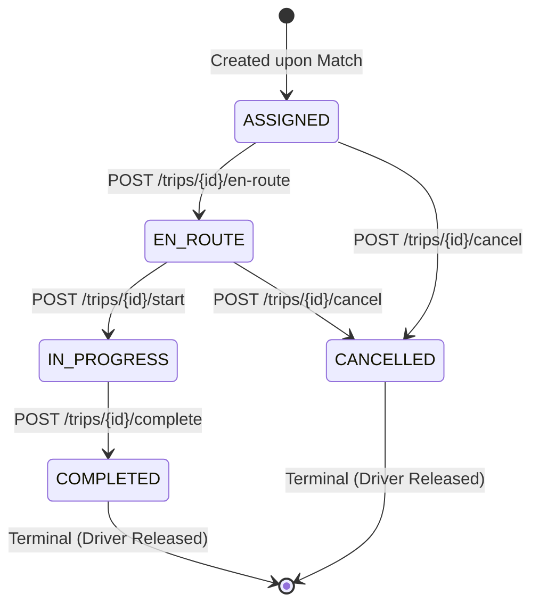

# Dispatch Service REST API & Event Ingestion Specification

This document provides the complete API specification for the Rendezvous dispatch matching service (`com.aagosh.dispatch`). It details the REST producer layer, asynchronous Kafka event streaming contracts, request polling interfaces, trip lifecycle operations, Redis caching behavior, batch telemetry, and Prometheus/Actuator observability endpoints.

---

## 1. Architectural Overview & Request Model

The dispatch platform uses an **asynchronous event ingestion gateway pattern** backed by Apache Kafka, Spring Boot Web, PostgreSQL, Redis, and an in-memory spatial matching engine.

```
+-------------------+           HTTP POST            +-----------------------+
|   Client / UI     | -----------------------------> | REST Producer Layer   |
| (Driver or Rider) | <----------------------------- | (Driver/Ride Control) |
+-------------------+       202 Accepted             +-----------+-----------+
                                                                 |
                                                                 | Publish Event
                                                                 v
                                                        [   Kafka Broker    ]
                                                                 |
                                                                 | Consume Batch
                                                                 v
+-------------------+       Poll Status (GET)        +-----------+-----------+
|   Client / UI     | <----------------------------- | Asynchronous Consumer |
| (Request Polling) |                                | (Matching & Persist)  |
+-------------------+                                +-----------+-----------+
                                                                 |
                                            +--------------------+--------------------+
                                            |                                         |
                                            v                                         v
                                   +-----------------+                       +-----------------+
                                   | PostgreSQL 16   |                       | In-Memory Engine|
                                   | (Durable State) |                       | (QuadTree & CAS)|
                                   +-----------------+                       +-----------------+
```

### 1.1 Asynchronous Acceptance vs. Terminal Status
- **Synchronous Ingestion (`HTTP 202 Accepted`):** Endpoints that ingest operational events (`POST /ping`, `POST /register`, `POST /request`) perform synchronous input validation and durable Kafka publication. Returning HTTP 202 confirms that the event was durably committed to the Kafka broker. It does **not** indicate that matching has completed or that a driver was assigned.
- **Terminal Status Determination (`HTTP 200 OK` via `GET /api/requests/{requestId}`):** Clients discover the final dispatch outcome by polling the request status endpoint. Processing concludes in one of two terminal states:
  - `MATCHED`: A suitable driver was found, claimed atomically via in-memory CAS, and persisted with an assignment record.
  - `NO_DRIVERS`: The search completed without finding an eligible driver (all drivers occupied, stale, or out of range); recorded durably in PostgreSQL.

### 1.2 Dual Route Prefix Conventions
The service supports two path conventions:
1. **Root-Relative Routes (Canonical Backend):** Endpoints such as `POST /ping`, `POST /register`, `POST /request`, `GET /drivers/{driverId}/location`, `GET /trips/{requestId}`, and `GET /telemetry/batches`.
2. **`/api/*` Route Aliases (Frontend & Proxy Integration):** Endpoints such as `POST /api/register`, `POST /api/request`, `GET /api/requests/{requestId}`, `GET /api/drivers/{driverId}/location`, `GET /api/trips/{requestId}`, and `GET /api/telemetry/batches`.
   - *Rationale:* The React/Vite development server ([frontend/vite.config.ts](frontend/vite.config.ts)) configures a reverse proxy forwarding `/api/*` to `http://localhost:8080`. Providing `/api` aliases enables uniform frontend client integration without requiring path rewrites or CORS configurations.

---

## 2. API Endpoint Matrix

| Method | Path(s) | Description | Success Code | Error Codes |
| :--- | :--- | :--- | :---: | :--- |
| `POST` | `/ping` | Submit driver GPS telemetry fix | `202 Accepted` | `400`, `503` |
| `POST` | `/register`, `/api/register` | Explicitly register driver | `202 Accepted` | `400`, `503` |
| `GET` | `/drivers/{driverId}/location`, `/api/drivers/{driverId}/location` | Query cached/latest driver location | `200 OK` | `400`, `404`, `409`, `503` |
| `POST` | `/request`, `/api/request` | Submit ride match request | `202 Accepted` | `400`, `503` |
| `GET` | `/api/requests/{requestId}` | Poll ride request match outcome | `200 OK` | `400`, `404` |
| `GET` | `/trips/{requestId}`, `/api/trips/{requestId}` | Query trip operational status | `200 OK` | `400`, `404` |
| `POST` | `/trips/{requestId}/en-route`, `/api/trips/{requestId}/en-route` | Transition trip to `EN_ROUTE` | `200 OK` | `400`, `404`, `409`, `503` |
| `POST` | `/trips/{requestId}/start`, `/api/trips/{requestId}/start` | Transition trip to `IN_PROGRESS` (pickup) | `200 OK` | `400`, `404`, `409`, `503` |
| `POST` | `/trips/{requestId}/complete`, `/api/trips/{requestId}/complete` | Transition trip to `COMPLETED` (drop-off) | `200 OK` | `400`, `404`, `409`, `503` |
| `POST` | `/trips/{requestId}/cancel`, `/api/trips/{requestId}/cancel` | Cancel trip (releases driver claim) | `200 OK` | `400`, `404`, `409`, `503` |
| `GET` | `/telemetry/batches`, `/api/telemetry/batches` | Query Kafka batch consumption telemetry | `200 OK` | `500` |
| `GET` | `/actuator/health` | Health and liveness/readiness probes | `200 OK` | `503` |
| `GET` | `/actuator/prometheus` | Prometheus Micrometer metrics scrape | `200 OK` | `500` |

---

## 3. Common Error Format & Validation Rules

All error responses adhere to a consistent RFC 7807-style error structure managed by `GlobalExceptionHandler`:

```json
{
  "status": 400,
  "error": "Bad Request",
  "message": "latitude must be a finite number between -90.0 and 90.0"
}
```

### Standard HTTP Status Codes
- **`400 Bad Request`:** Raised on malformed JSON bodies, missing required parameters, or coordinate validation failures (latitude outside $[-90.0, 90.0]$, longitude outside $[-180.0, 180.0]$, or non-finite values).
- **`404 Not Found`:** Raised when querying an unregistered driver, a non-existent trip, an unpersisted ride request, or accessing disabled endpoints.
- **`409 Conflict`:** Raised when an operation violates state constraints (e.g., driver location is stale or unverified, trip state transition is illegal, or driver ownership mismatch).
- **`500 Internal Server Error`:** Unhandled server exception.
- **`503 Service Unavailable`:** Raised when Kafka broker publication times out (after 5 seconds), or when database and in-memory states diverge under extreme contention.

---

## 4. Driver Telemetry & Registration Endpoints

### 4.1 Ingest Driver Telemetry (`POST /ping`)
Submits a driver GPS location update. Publishes an event to Kafka topic `driver-pings` with `driverId` as the message key to preserve partition affinity.

- **URL:** `POST /ping`
- **Headers:** `Content-Type: application/json`
- **Success Status:** `202 Accepted`

#### Request Schema (`DriverPingRequest`)
| Field | Type | Required | Default | Description |
| :--- | :--- | :---: | :---: | :--- |
| `driverId` | `String` | Yes | - | Non-blank driver identifier (e.g., `"D101"`). |
| `latitude` | `Double` | Yes | - | WGS-84 latitude between `-90.0` and `90.0`. |
| `longitude` | `Double` | Yes | - | WGS-84 longitude between `-180.0` and `180.0`. |
| `action` | `String` | No | `"AUTO"` | Processing mode: `"AUTO"`, `"UPDATE"`, or `"REGISTER"`. |
| `capturedAt`| `Long` | No | `null` | Optional client fix timestamp in epoch milliseconds. |

#### Operational Semantics by Action Mode
- **`AUTO` (Default):** Registers the driver if absent; updates coordinates if already registered. Strictly preserves existing `DriverState` (active ride claims are never overwritten).
- **`REGISTER`:** Registers driver if absent; duplicate registrations are acknowledged idempotently.
- **`UPDATE`:** Updates coordinates of an existing driver; pings for unknown drivers are acknowledged without registering.

#### Example Request & Response
```http
POST /ping HTTP/1.1
Content-Type: application/json

{
  "driverId": "D101",
  "latitude": 17.385044,
  "longitude": 78.486671,
  "action": "AUTO",
  "capturedAt": 1776500000000
}
```

```http
HTTP/1.1 202 Accepted
Content-Type: application/json

{
  "driverId": "D101",
  "message": "Driver ping accepted and queued for processing"
}
```

---

### 4.2 Explicit Driver Registration (`POST /register` & `POST /api/register`)
Convenience route for explicit driver onboarding. Equivalent to calling `POST /ping` with `action: "REGISTER"`.

- **URLs:** `POST /register` (canonical) or `POST /api/register` (alias)
- **Headers:** `Content-Type: application/json`
- **Success Status:** `202 Accepted`

#### Example Request & Response
```http
POST /api/register HTTP/1.1
Content-Type: application/json

{
  "driverId": "D102",
  "latitude": 17.390000,
  "longitude": 78.490000
}
```

```http
HTTP/1.1 202 Accepted
Content-Type: application/json

{
  "driverId": "D102",
  "message": "Driver registration accepted and queued for processing"
}
```

---

### 4.3 Query Driver Location (`GET /drivers/{driverId}/location` & `GET /api/drivers/{driverId}/location`)
Queries the latest location of a driver. 

- **URLs:** `GET /drivers/{driverId}/location` (canonical) or `GET /api/drivers/{driverId}/location` (frontend proxy alias)
- **Headers:** `Accept: application/json`

#### Cache Read-Through Architecture
1. **Redis Cache:** Checks Redis hash key `driver:{driverId}:location` (30-second TTL, updated via conditional Lua script on incoming pings).
2. **Fallback:** If Redis is down or reports a cache miss, seamlessly reads from the in-memory `DriverRegistry`.
3. **Freshness Verification:** Compares the timestamp against `dispatch.matching.driver-staleness-seconds` (default: 60 seconds) and clock-skew bounds.

#### Response Statuses & Schema (`DriverLocationResponse`)
- **`200 OK` (Fresh):** Driver found and timestamp is fresh ($\le 60\text{s}$). `fresh: true`.
- **`409 Conflict` (Stale / Unverified):** Driver found but location is older than 60s or timestamp is future-skewed. `fresh: false`. Returns coordinates for client decision-making.
- **`404 Not Found`:** Driver is not registered in the system.
- **`503 Service Unavailable`:** Redis connection failed and driver is not present in in-memory registry.

#### Example: Fresh Location (HTTP 200)
```http
GET /drivers/D101/location HTTP/1.1
```

```http
HTTP/1.1 200 OK
Content-Type: application/json

{
  "driverId": "D101",
  "latitude": 17.385044,
  "longitude": 78.486671,
  "updatedAt": "2026-10-18T08:00:00Z",
  "fresh": true
}
```

#### Example: Stale Location (HTTP 409)
```http
HTTP/1.1 409 Conflict
Content-Type: application/json

{
  "driverId": "D101",
  "latitude": 17.385044,
  "longitude": 78.486671,
  "updatedAt": "2026-10-18T07:55:00Z",
  "fresh": false
}
```

---

## 5. Ride Request Submission & Status Polling

### 5.1 Submit Ride Request (`POST /request` & `POST /api/request`)
Validates pickup coordinates and publishes the request to the `ride-requests` Kafka topic using `requestId` as the message key.

- **URLs:** `POST /request` (canonical) or `POST /api/request` (alias)
- **Headers:** `Content-Type: application/json`
- **Success Status:** `202 Accepted`

#### Request Schema (`RideRequestDto`)
| Field | Type | Required | Description |
| :--- | :--- | :---: | :--- |
| `requestId` (or `id`) | `String` | Yes | Unique non-blank request identifier (e.g., `"REQ-789"`). |
| `latitude` | `Double` | Yes | Pickup latitude between `-90.0` and `90.0`. |
| `longitude` | `Double` | Yes | Pickup longitude between `-180.0` and `180.0`. |

#### Example Request & Response
```http
POST /api/request HTTP/1.1
Content-Type: application/json

{
  "requestId": "REQ-789",
  "latitude": 17.387000,
  "longitude": 78.488000
}
```

```http
HTTP/1.1 202 Accepted
Content-Type: application/json

{
  "requestId": "REQ-789",
  "message": "Ride request accepted and queued for matching"
}
```

---

### 5.2 Poll Ride Request Status (`GET /api/requests/{requestId}`)
Retrieves the current persisted status of a ride request.

- **URL:** `GET /api/requests/{requestId}`
- **Headers:** `Accept: application/json`

#### Response States (`RequestStatusResponse`)
1. **`PENDING`:** Request received and persisted by Kafka consumer; matching computation is in-flight.
2. **`MATCHED`:** Driver assigned. Includes `driverId` and real-time telemetry coordinates (`driverLatitude`, `driverLongitude`, `driverLocationAt`) if the driver is fresh.
3. **`NO_DRIVERS`:** Terminal state reached when no eligible or available drivers could be matched.

#### Response Status Codes
- **`200 OK`:** Request record found in PostgreSQL.
- **`404 Not Found`:** Request has not yet been processed by the Kafka consumer into the database, or ID does not exist. (Clients should interpret 404 as "not yet visible" during the initial poll and retry).

#### Example: Matched Outcome (HTTP 200)
```http
GET /api/requests/REQ-789 HTTP/1.1
```

```http
HTTP/1.1 200 OK
Content-Type: application/json

{
  "requestId": "REQ-789",
  "status": "MATCHED",
  "driverId": "D101",
  "receivedAt": "2026-10-18T08:00:00.100Z",
  "updatedAt": "2026-10-18T08:00:00.150Z",
  "driverLatitude": 17.385044,
  "driverLongitude": 78.486671,
  "driverLocationAt": "2026-10-18T08:00:00Z"
}
```

#### Example: No Drivers Outcome (HTTP 200)
```http
HTTP/1.1 200 OK
Content-Type: application/json

{
  "requestId": "REQ-789",
  "status": "NO_DRIVERS",
  "driverId": null,
  "receivedAt": "2026-10-18T08:00:00.100Z",
  "updatedAt": "2026-10-18T08:00:00.250Z",
  "driverLatitude": null,
  "driverLongitude": null,
  "driverLocationAt": null
}
```

---

## 6. Trip Lifecycle State Machine & Operations

When a ride request is matched, an associated `trips` record is created in status `ASSIGNED`. The driver progresses through an explicit operational state machine.

### 6.1 State Machine Transition Rules



| Current Status | Target Endpoint | Next Status | Permitted | Driver Action |
| :--- | :--- | :--- | :---: | :--- |
| `ASSIGNED` | `/en-route` | `EN_ROUTE` | Yes | Driver begins traveling to pickup point |
| `ASSIGNED` | `/cancel` | `CANCELLED` | Yes | Rider or driver cancels before departure |
| `EN_ROUTE` | `/start` | `IN_PROGRESS` | Yes | Passenger picked up; trip starts |
| `EN_ROUTE` | `/cancel` | `CANCELLED` | Yes | Cancellation while driver is en route |
| `IN_PROGRESS`| `/complete` | `COMPLETED` | Yes | Passenger dropped off; trip complete |
| `IN_PROGRESS`| `/cancel` | `CANCELLED` | **No** (409) | Cancellation forbidden once in progress |
| Any Terminal | Any | Any | **No** (409) | Status transitions from terminal states rejected |

> [!IMPORTANT]
> **Option-B Transaction Sequencing & Driver Claim Release:**  
> All trip transitions commit the database row in PostgreSQL *first* via `TripTransitionPersistor`. Only after durable database commit does `TripLifecycleService` mutate the in-memory `DriverState`.  
> Reaching terminal states (`COMPLETED` or `CANCELLED`) automatically invokes `DriverState.completeTrip(requestId)` or `DriverState.cancelTrip(requestId)`, releasing the driver's atomic claim back to `AVAILABLE` for future matching.

---

### 6.2 Trip Status Query (`GET /trips/{requestId}` & `GET /api/trips/{requestId}`)

- **URLs:** `GET /trips/{requestId}` or `GET /api/trips/{requestId}`
- **Headers:** `Accept: application/json`

#### Example Response (`TripResponse`)
```http
HTTP/1.1 200 OK
Content-Type: application/json

{
  "requestId": "REQ-789",
  "driverId": "D101",
  "status": "EN_ROUTE",
  "createdAt": "2026-10-18T08:00:00.150Z",
  "updatedAt": "2026-10-18T08:01:10.500Z"
}
```

---

### 6.3 Lifecycle Transition Endpoints

All transition endpoints require a JSON body specifying the driver ID attempting the action:

#### Request Schema (`TripLifecycleRequest`)
| Field | Type | Required | Description |
| :--- | :--- | :---: | :--- |
| `driverId` | `String` | Yes | Driver identifier; must match the assigned trip owner. |

#### Transition Routes:
1. **Depart to Pickup:** `POST /trips/{requestId}/en-route` (or `/api/trips/{requestId}/en-route`)
2. **Start Trip (Passenger Pickup):** `POST /trips/{requestId}/start` (or `/api/trips/{requestId}/start`)
3. **Complete Trip (Drop-Off):** `POST /trips/{requestId}/complete` (or `/api/trips/{requestId}/complete`)
4. **Cancel Trip:** `POST /trips/{requestId}/cancel` (or `/api/trips/{requestId}/cancel`)

#### Response Schema (`TripLifecycleResponse`)
```json
{
  "requestId": "REQ-789",
  "driverId": "D101",
  "status": "EN_ROUTE",
  "outcome": "TRANSITIONED",
  "message": "Trip successfully transitioned to EN_ROUTE"
}
```

#### Lifecycle Transition Error Codes & Outcomes
- **`200 OK` (Outcome: `TRANSITIONED`):** State updated successfully in database and memory.
- **`200 OK` (Outcome: `ALREADY_IN_TARGET_STATE`):** Idempotent replay; the trip was already in the requested state.
- **`409 Conflict` (Outcome: `INVALID_TRANSITION`):** Illegal transition attempted (e.g. attempting to cancel an `IN_PROGRESS` trip).
- **`409 Conflict` (Outcome: `OWNERSHIP_MISMATCH`):** The provided `driverId` does not match the driver recorded on the trip.
- **`404 Not Found` (Outcome: `TRIP_NOT_FOUND`):** No trip exists for the specified `requestId`.
- **`404 Not Found` (Outcome: `DRIVER_NOT_FOUND`):** Driver is not present in `DriverRegistry`.
- **`503 Service Unavailable` (Outcome: `DRIVER_STATE_DIVERGED`):** Database committed but in-memory CAS failed due to concurrent modification; lazy recovery occurs on next ping.

---

## 7. Kafka Batch Telemetry (`GET /telemetry/batches` & `/api/telemetry/batches`)

Exposes a read-only snapshot of adaptive batch consumption metrics collected by `AdaptiveWindowController`.

- **URLs:** `GET /telemetry/batches` (canonical) or `GET /api/telemetry/batches` (alias)
- **Headers:** `Accept: application/json`

#### Response Schema (`BatchTelemetryResponse`)
| Field | Type | Description |
| :--- | :--- | :--- |
| `totalBatches` | `Long` | Total consumer poll batches processed since startup. |
| `totalRequests` | `Long` | Total ride requests processed across all batches. |
| `lastBatchSize` | `Integer` | Number of records in the most recent consumer poll. |
| `maxObservedBatchSize` | `Integer` | Peak batch size recorded during runtime. |
| `averageBatchSize` | `Double` | Cumulative mean batch size (`totalRequests / totalBatches`). |
| `estimatedArrivalRate` | `Double` | Exponential moving average arrival rate ($\lambda$ in requests/sec). |
| `targetWindowNanos` | `Long` | Dynamic accumulation window in nanoseconds (Little's Law). |
| `targetBatchSize` | `Integer` | Target batch size computed for current arrival rate. |

#### Example Response
```http
HTTP/1.1 200 OK
Content-Type: application/json

{
  "totalBatches": 3950,
  "totalRequests": 4424,
  "lastBatchSize": 2,
  "maxObservedBatchSize": 3,
  "averageBatchSize": 1.12,
  "estimatedArrivalRate": 59.8,
  "targetWindowNanos": 200000000,
  "targetBatchSize": 10
}
```

---

## 8. Observability & Health Probes

### 8.1 Health Endpoint (`GET /actuator/health`)
Provides liveness and readiness probe status for container orchestrators.

- **URL:** `GET /actuator/health`
- **Headers:** `Accept: application/json`

```http
HTTP/1.1 200 OK
Content-Type: application/vnd.spring-boot.actuator.v3+json

{
  "status": "UP",
  "groups": [
    "liveness",
    "readiness"
  ]
}
```

### 8.2 Prometheus Metrics (`GET /actuator/prometheus`)
Exposes Micrometer counters, timers, distribution summaries, and gauges formatted for Prometheus scraping (scraped by local Prometheus every 5 seconds).

- **URL:** `GET /actuator/prometheus`
- **Format:** Prometheus text format / OpenMetrics

#### Core Metrics Exported
- `dispatch_requests_total`: Counter of received ride requests by status tag (`PENDING`, `MATCHED`, `NO_DRIVERS`).
- `dispatch_matches_total`: Counter of successful driver assignments.
- `dispatch_no_drivers_total`: Counter of terminal unassigned outcomes.
- `dispatch_claim_attempts_total`, `dispatch_claim_success_total`, `dispatch_claim_contention_total`: Atomic driver CAS claim metrics.
- `dispatch_persistence_writes_total`, `dispatch_persistence_failures_total`: Transactional write metrics.
- `dispatch_cache_hits_total`, `dispatch_cache_misses_total`, `dispatch_cache_errors_total`: Non-authoritative Redis cache metrics.
- `dispatch_drivers_registered`, `dispatch_drivers_fresh`: In-memory fleet capacity gauges.
- `dispatch_latency_seconds`: Timer measuring end-to-end match computation duration.
- `dispatch_batch_duration_seconds`, `dispatch_batch_size`: Adaptive Kafka consumer performance summaries.

#### Security & Endpoint Exposure Policy
Per `application.properties`, only `health` and `prometheus` endpoints are exposed over HTTP. Sensitive actuator modules (`/actuator/env`, `/actuator/beans`, `/actuator/heapdump`, `/actuator/shutdown`) are explicitly disabled and return HTTP `404 Not Found`.

---

## 9. Delivery Semantics & Two-Tier Idempotency

1. **At-Least-Once Delivery:** Kafka guarantees at-least-once message delivery. Consumers are architected to anticipate redeliveries due to network rebalances or container restarts.
2. **Two-Tier Idempotency Architecture:**
   - **Tier 1 (In-Memory Fast Path):** `RideRequestConsumer` maintains an in-flight reservation monitor and an LRU cache of recently processed request IDs (up to 10,000 entries). Repeated deliveries within the active window are skipped immediately.
   - **Tier 2 (Durable Database State):** Before matching, the consumer executes a single batched lookup (`findFinalizedRequestIdsIn`) against PostgreSQL. If a request has already reached `MATCHED` or `NO_DRIVERS`, the consumer confirms the outcome and commits the offset without rematching.
3. **Database Constraints:** PostgreSQL enforces `UNIQUE (request_id)` on both `ride_requests` and `assignments` tables. Concurrent attempts to insert duplicate assignments trigger a unique constraint violation that rolls back the transaction safely.
4. **Offset Commit Sequencing:** Kafka offset acknowledgement (`ack.acknowledge()`) executes **strictly after** the database transaction has committed, guaranteeing no data loss on worker crash.

---

## 10. References & Further Documentation

- [Project README](README.md) - Comprehensive setup instructions, 7-service port topology, Docker Compose configuration, and test breakdown.
- [Phase 8 Benchmark Evidence Report](docs/benchmarks/phase-8-alternative-a-report.md) - High-load empirical findings, latency distributions, and batching analysis under full JIT compilation.
- [Phase 9 Observability Benchmark Report](docs/benchmarks/phase-9-observability-report.md) - Empirical assessment of Prometheus/Grafana observability overhead under 60 req/s load, latency comparison, and live dashboard validation.
- [Double-Booking Concurrency Experiment](docs/double-booking-experiment.md) - Multi-threaded race condition analysis and atomic CAS proof.
