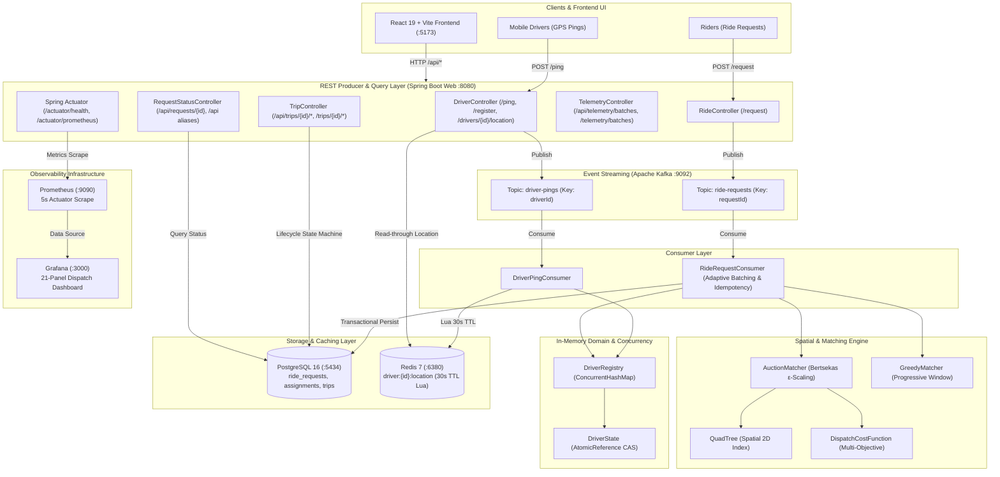

# Real-Time Ride Dispatch Matching Engine

A high-performance, concurrency-safe dispatch matching platform implemented with a Java 17 and Spring Boot backend and an interactive React, TypeScript, and Vite frontend. The platform models a two-sided mobility network featuring asynchronous event ingestion via Apache Kafka for high-throughput driver location telemetry and ride requests, 2D hierarchical spatial indexing, multi-objective dispatch cost evaluation, atomic driver-rider bipartite assignment with zero double-booking under extreme concurrency, durable PostgreSQL state persistence, non-authoritative Redis location caching, and Prometheus/Grafana observability.

---

## 1. Problem Statement & Architecture

In real-time ride-hailing networks, dispatching rides involves competing operational requirements:
1. **Asynchronous High-Throughput Ingestion:** Decoupling HTTP submission from matching computation using Kafka message queues, returning immediate `202 Accepted` receipts to clients.
2. **Low Latency & Spatial Indexing:** Finding candidate drivers near a pickup location without full-fleet $O(N)$ linear scans using hierarchical spatial indexes.
3. **Global Assignment Optimality:** Minimizing deadhead travel time and balancing fleet distribution rather than greedily consuming suboptimal drivers.
4. **Strict Concurrency Safety:** Guaranteeing that under thousands of concurrent dispatch requests, no driver can ever be double-booked to two distinct ride requests (lost-update anomaly), and driver location telemetry updates never overwrite or clear active ride claims.
5. **Durable Persistence & End-to-End Observability:** Storing terminal ride outcomes and trip lifecycles in PostgreSQL, providing non-authoritative driver location caching in Redis, and exposing real-time Micrometer metrics scraped by Prometheus and visualized in Grafana.

### System Architecture



---

## 2. Prerequisites, Local Setup & Port Topology

### 2.1 Prerequisites
- **Java Development Kit (JDK):** Version 17 or higher (tested with Eclipse Adoptium OpenJDK 17.0.20)
- **Build Tool:** Apache Maven 3.9+ (or the included `./mvnw` / `mvnw.cmd` wrapper)
- **Node.js & npm:** Node.js 18+ (tested with v22.13.1) and npm 9+ (tested with 11.6.0) for frontend development
- **Container Runtime:** Docker Engine and Docker Compose v2+
- **Load Testing Tool (Optional):** [k6](https://k6.io/) v0.50+ for executing benchmark scenarios

### 2.2 Infrastructure Services & Port Allocation

The platform components communicate across the following host and container ports:

| Service | Component | Host Port | Container Port | Protocol / Endpoints | Operational Purpose |
| :--- | :--- | :---: | :---: | :--- | :--- |
| **Backend** | Spring Boot (`dispatch`) | `8080` | `8080` (host) | HTTP (`/api/*`, `/actuator/*`) | REST ingestion, Kafka producers/consumers, spatial matching engine |
| **Frontend** | React + Vite (`rendezvous-frontend`) | `5173` | `5173` (host) | HTTP (`/`) | Real-time interactive UI, MapLibre GL map, fleet simulation, reverse proxy `/api` |
| **PostgreSQL** | Database (`postgres:16`) | `5434` | `5432` | JDBC (`dispatch_db`) | Durable request status, assignments, and trip lifecycle tables (Flyway V1–V3) |
| **Redis** | Cache (`redis:7`) | `6380` | `6379` | RESP | Non-authoritative location cache (`driver:{id}:location`, 30s TTL, Lua script) |
| **Kafka** | Message Broker (`apache/kafka:3.7.0`) | `9092` | `9092` | PLAINTEXT | Asynchronous event streaming (`driver-pings`, `ride-requests`) |
| **Prometheus** | Metrics Collector (`prom/prometheus:v2.54.1`) | `9090` | `9090` | HTTP (`/`) | Scrapes backend `/actuator/prometheus` via `host.docker.internal:8080` every 5s |
| **Grafana** | Visualization UI (`grafana/grafana:11.2.0`) | `3000` | `3000` | HTTP (`/`) | Pre-provisioned 21-panel operations dashboard (anonymous viewer access enabled) |

> [!IMPORTANT]
> **PostgreSQL Host Port Mapping:**  
> The PostgreSQL container maps host port **`5434`** to container port `5432` to avoid conflicting with any default local PostgreSQL instance on port `5432`. The backend connection URL is configured as `jdbc:postgresql://localhost:5434/dispatch_db`.

---

### 2.3 Environment Configuration

The repository provides a template environment file (`.env.example`) containing non-sensitive variable definitions and placeholders.

1. **Create Local Environment File:**
   ```bash
   cp .env.example .env
   ```
2. **Configure Local Variables:**
   Open `.env` in an editor and replace placeholder values with your desired local credentials:
   ```env
   GRAFANA_ADMIN_USER=admin
   GRAFANA_ADMIN_PASSWORD=<change-me-to-a-secure-password>
   ```
   > [!WARNING]
   > `.env` is ignored by Git and must **never** be committed to version control. The repository tracks `.env.example` with placeholders only.

3. **Backend Configuration Reference (`application.properties`):**
   The Spring Boot application automatically resolves default connections to local Docker Compose services, which can be overridden via environment variables:

   | Environment Variable | Default Value | Description |
   | :--- | :--- | :--- |
   | `SPRING_DATASOURCE_URL` | `jdbc:postgresql://localhost:5434/dispatch_db?options=-c%20timezone=UTC` | PostgreSQL JDBC connection URL |
   | `SPRING_DATASOURCE_USERNAME` | `dispatch_user` | PostgreSQL database username |
   | `SPRING_DATASOURCE_PASSWORD` | `dispatch_password` | PostgreSQL database password |
   | `SPRING_KAFKA_BOOTSTRAP_SERVERS` | `localhost:9092` | Kafka bootstrap broker list |
   | `SPRING_REDIS_HOST` | `localhost` | Redis server hostname |
   | `SPRING_REDIS_PORT` | `6380` | Redis server port |
   | `SPRING_REDIS_PASSWORD` | *(empty)* | Optional Redis password |
   | `GRAFANA_ADMIN_USER` | `admin` | Grafana admin username |
   | `GRAFANA_ADMIN_PASSWORD` | *(required in .env)* | Grafana admin password |

---

### 2.4 Local Infrastructure Startup (Docker Compose)

Start all five infrastructure services (PostgreSQL, Redis, Kafka, Prometheus, and Grafana):

```bash
# Start all infrastructure containers in detached mode
docker compose up -d

# Verify container status and port mappings
docker compose ps
```

To stop infrastructure containers without deleting volume data:
```bash
docker compose stop
```

To tear down containers and delete attached volumes:
```bash
docker compose down -v
```

---

### 2.5 Backend Build & Run

Ensure the infrastructure containers are running before starting the Spring Boot backend:

```bash
# Package the application (skipping tests for quick startup)
./mvnw clean package -DskipTests

# Run the Spring Boot application locally (starts on http://localhost:8080)
./mvnw spring-boot:run
```

The application will:
1. Connect to PostgreSQL on port `5434` and run Flyway schema migrations (`V1`, `V2`, `V3`).
2. Connect to Redis on port `6380` to initialize the location cache.
3. Connect to Kafka on port `9092` and verify topic bindings.
4. Expose Actuator health probes at `http://localhost:8080/actuator/health` and Prometheus metrics at `http://localhost:8080/actuator/prometheus`.

---

### 2.6 Frontend Setup & Run

The interactive frontend is built with React 19, TypeScript, Vite, and MapLibre GL.

```bash
# Navigate to the frontend directory
cd frontend

# Install dependencies
npm install

# Start the Vite development server (starts on http://localhost:5173)
npm run dev
```

The Vite dev server runs at **`http://localhost:5173`** and includes a built-in reverse proxy forwarding all `/api/*` requests to the Spring Boot backend at `http://localhost:8080`.

Additional frontend scripts:
```bash
# Run the complete Vitest test suite in single-run mode
npm test

# Run tests in interactive watch mode
npm run test:watch

# Perform strict TypeScript type checking without emitting files
npm run typecheck

# Build the production bundle
npm run build

# Preview the production build locally
npm run preview
```

---

### 2.7 Observability (Prometheus & Grafana)

The platform includes pre-configured monitoring services:

1. **Prometheus UI:** Navigate to **`http://localhost:9090`**.
   - Scrapes the backend application via `host.docker.internal:8080/actuator/prometheus` every 5 seconds.
   - You can query raw metrics such as `dispatch_requests_total`, `dispatch_matches_total`, and `dispatch_batch_duration_seconds`.

2. **Grafana Operations Dashboard:** Navigate to **`http://localhost:3000`**.
   - **Anonymous Viewer:** Grafana is configured with anonymous access (`GF_AUTH_ANONYMOUS_ENABLED=true`), enabling direct access to the dashboard without entering credentials.
   - **Admin Access:** To edit panels or change settings, log in using username `admin` and the password configured in your `.env` file (`GRAFANA_ADMIN_PASSWORD`).
   - **Provisioned Dashboard:** The pre-loaded dashboard (**"Dispatch Matching Engine Overview"**) provides 21 panels visualizing:
     - End-to-end ingestion and match rates.
     - Atomic driver claim success and contention rates.
     - End-to-end dispatch and ingestion latency distributions (p50, p95, p99).
     - Adaptive Kafka consumer batch sizes and processing durations.
     - Database persistence throughput and error counts.
     - Non-authoritative Redis cache hit, miss, and error ratios.

---

### 2.8 Load Testing & Benchmarking (k6)

The project includes an open-loop load testing harness built with [k6](https://k6.io/) to evaluate latency, throughput, and database integrity under load.

#### Step 1: Seed the Driver Pool
Before executing benchmarks, populate the in-memory registry and Redis cache with simulated drivers centered around Hyderabad coordinates:

```bash
# Seed 200 fresh drivers (idempotent, calls POST /ping with action: AUTO)
node scripts/seed-drivers.js --count 200

# Optional: Run a continuous background heartbeat to refresh driver timestamps every 30s
node scripts/seed-drivers.js --count 200 --loop --interval 30
```

#### Step 2: Execute Scenarios
```bash
# Low-Load Benchmark: constant arrival rate at 3 req/s for 60 seconds
k6 run k6/low-load.js

# High-Load Benchmark: ramping arrival rate from 10 to 60 req/s sustained for 60 seconds
k6 run k6/high-load.js

# Run with a custom base URL:
k6 run -e DISPATCH_BASE_URL=http://localhost:8080 k6/high-load.js
```

For detailed methodology, JIT configuration, and empirical findings, see the [Phase 8 Benchmark Evidence Report](docs/benchmarks/phase-8-alternative-a-report.md) and the [Phase 9 Observability Benchmark Report](docs/benchmarks/phase-9-observability-report.md).

---

## 3. Package & Module Structure

The project is structured under `com.aagosh.dispatch` and `frontend/`:

```
c:\Aagosh\CODE\JAVA\dispatch\
├── src/main/java/com/aagosh/dispatch/
│   ├── DispatchApplication.java            # Spring Boot application bootstrap
│   ├── api/                                # REST controllers, DTOs, and exception handlers
│   │   ├── DriverController.java          # REST producer for /ping, /register, GET /drivers/{id}/location
│   │   ├── RideController.java            # REST producer for /request (202 Accepted)
│   │   ├── RequestStatusController.java   # REST query for GET /api/requests/{id} & route aliases
│   │   ├── TripController.java            # REST controller for /api/trips/{id} & /trips/{id} lifecycle
│   │   ├── TelemetryController.java       # REST controller for /api/telemetry/batches & /telemetry/batches
│   │   ├── DriverPingRequest.java         # Driver telemetry payload DTO
│   │   ├── DriverPingAcceptedResponse.java# Async 202 response for telemetry
│   │   ├── DriverLocationResponse.java    # Driver location response DTO
│   │   ├── RideRequestDto.java            # Ride match request payload DTO
│   │   ├── RideAcceptedResponse.java      # Async 202 response for ride submission
│   │   ├── RequestStatusResponse.java     # Request polling outcome DTO
│   │   ├── TripLifecycleRequest.java      # Trip transition request DTO
│   │   ├── TripLifecycleResponse.java     # Trip transition response DTO
│   │   ├── BatchTelemetryResponse.java    # Batch processing metrics DTO
│   │   ├── ApiErrorResponse.java          # RFC 7807-style error payload DTO
│   │   └── GlobalExceptionHandler.java    # @RestControllerAdvice for validation & runtime errors
│   ├── cache/                             # Distributed caching layer
│   │   └── RedisLocationCache.java        # Redis template wrapper (30s TTL, Lua conditional write)
│   ├── config/                             # Spring bean configuration
│   │   ├── DispatchConfig.java            # Matching strategy & cost configuration beans
│   │   ├── DriverFreshnessConfig.java     # Driver staleness threshold configuration (60s default)
│   │   ├── KafkaConfig.java               # KafkaAdmin, ProducerFactory, ConsumerFactory, Topics
│   │   ├── KafkaTopics.java               # Topic name constants
│   │   └── RedisConfig.java               # RedisConnectionFactory & StringRedisTemplate setup
│   ├── domain/                             # Core domain entities and concurrency primitives
│   │   ├── Driver.java                    # Driver record with ID, GeoPoint, and DriverState
│   │   ├── DriverRegistry.java            # Thread-safe in-memory registry (ConcurrentHashMap)
│   │   ├── DriverState.java               # AtomicReference-backed CAS claiming state machine
│   │   ├── GeoPoint.java                  # Validated coordinate record (lat/lon)
│   │   ├── MatchStatus.java               # Enum: AVAILABLE, CLAIMED, UNAVAILABLE
│   │   ├── RideRequest.java               # Ride request domain record
│   │   └── TripStatus.java                # Enum: DISPATCHED, EN_ROUTE, IN_PROGRESS, COMPLETED, CANCELLED
│   ├── matching/                           # Spatial indexing and matching algorithms
│   │   ├── Assignment.java                # Immutable match pair (Driver, RideRequest, cost)
│   │   ├── AuctionMatcher.java            # Bertsekas' Auction Algorithm with ε-scaling
│   │   ├── DispatchCostConfig.java        # Cost function weights and normalizers
│   │   ├── DispatchCostFunction.java      # Multi-objective normalized cost calculator
│   │   ├── GreedyMatcher.java             # Progressive-radius nearest-neighbor matcher
│   │   ├── Matcher.java                   # Core matching strategy interface
│   │   └── RequestDensityIndex.java       # Spatial density index for competition cost
│   ├── messaging/                          # Kafka consumers & batch controllers
│   │   ├── AdaptiveWindowController.java  # Adaptive batching controller (10ms-200ms window)
│   │   ├── DriverPingConsumer.java        # Consumes driver-pings, updates registry & Redis
│   │   └── RideRequestConsumer.java       # Consumes ride-requests, matches & persists atomically
│   ├── metrics/                            # Observability & Micrometer instrumentation
│   │   └── DispatchMetrics.java           # Centralized metrics facade (meters, counters, gauges)
│   ├── persistence/                        # Durable state & transactional persistence
│   │   ├── AssignmentEntity.java          # JPA entity for assignments table
│   │   ├── AssignmentPersistenceService.java # Transactional boundary & claim reconciliation
│   │   ├── AssignmentRepository.java      # Spring Data JPA repository for assignments
│   │   ├── PersistOutcome.java            # Outcome enum (PERSISTED, DUPLICATE, FAILURE)
│   │   ├── RideRequestEntity.java         # JPA entity for ride_requests table
│   │   ├── RideRequestRepository.java     # Spring Data JPA repository for ride requests
│   │   ├── TripEntity.java                # JPA entity for trips table
│   │   ├── TripLifecycleService.java      # Trip transition service & driver release
│   │   └── TripRepository.java            # Spring Data JPA repository for trips
│   └── spatial/                            # Spatial indexing primitives
│       ├── BoundingBox.java               # Coordinate bounding box with intersection logic
│       └── QuadTree.java                  # Hierarchical 2D spatial index for proximity pruning
│
├── src/main/resources/
│   ├── application.properties             # Spring Boot properties, datasource, kafka, redis, metrics
│   └── db/migration/                      # Flyway schema migrations
│       ├── V1__create_ride_requests.sql   # ride_requests table with UNIQUE(request_id)
│       ├── V2__create_assignments.sql     # assignments table with UNIQUE(request_id) & FK
│       └── V3__create_trips.sql           # trips table with status tracking and foreign keys
│
├── frontend/                              # Interactive web application (React 19 + TypeScript + Vite)
│   ├── package.json                       # Scripts: dev, build, test, typecheck
│   ├── vite.config.ts                     # Port 5173, reverse proxy /api -> http://localhost:8080
│   └── src/                               # UI components, hooks, services, MapLibre GL map
│
├── infra/                                 # Infrastructure provisioning
│   ├── prometheus/prometheus.yml          # Prometheus scrape configuration (5s interval)
│   └── grafana/provisioning/              # Datasource & 21-panel dashboard provisioning
│
├── k6/                                    # Load testing scenarios
│   ├── common.js                          # Shared k6 utilities, payloads, telemetry polling
│   ├── low-load.js                        # Constant arrival rate (3 req/s)
│   └── high-load.js                       # Ramping arrival rate (10 -> 60 req/s)
│
└── scripts/
    └── seed-drivers.js                    # Pre-test driver seeding and freshness refresh utility
```

---

## 4. End-to-End Request Flows

### Flow 1: Driver Ingestion & Telemetry (`POST /ping`)
1. Client submits driver ID and GPS coordinates.
2. `DriverController` synchronously validates coordinates (`[-90, 90]`, `[-180, 180]`).
3. Payload is published to Kafka topic `driver-pings` using `driverId` as message key (preserving partition affinity).
4. On durable broker confirmation, HTTP `202 Accepted` is returned. If Kafka fails, HTTP `503 Service Unavailable` is returned.
5. `DriverPingConsumer` processes the event asynchronously:
   - Updates coordinates via atomic CAS loop on `AtomicReference<Driver>`.
   - Strictly preserves the authoritative `DriverState` instance, ensuring that telemetry never resets an active ride claim.
   - Updates the non-authoritative Redis location cache (`driver:{id}:location`) with a 30-second TTL using a conditional Lua script.

### Flow 2: Ride Dispatch Matching (`POST /request`)
1. Client submits pickup location and request ID.
2. `RideController` synchronously validates input and publishes to `ride-requests` with `requestId` as message key.
3. On broker confirmation, HTTP `202 Accepted` is returned.
4. `RideRequestConsumer` receives the batch:
   - Fast-path checks in-memory LRU cache (`processedRequests`) to skip redelivered duplicates.
   - Queries PostgreSQL (`findFinalizedRequestIdsIn`) to eliminate previously persisted requests.
   - Snapshots fresh drivers ($\le 60\text{s}$ staleness) from `DriverRegistry`.
   - Invokes the configured `Matcher` (`AuctionMatcher` by default).
   - If an assignment is computed, claims the driver atomically via `DriverState.tryClaim(requestId)`.
   - Persists the assignment and updates the request status to `MATCHED` within a single database transaction.
   - If no driver is found, records `NO_DRIVERS` in PostgreSQL.
   - Acknowledges Kafka offsets strictly after the database commit completes.

### Flow 3: Request Status Polling (`GET /api/requests/{requestId}`)
1. Client polls request outcome using the returned `requestId`.
2. `RequestStatusController` checks PostgreSQL `ride_requests` and `assignments` tables.
3. Returns `PENDING` (still in matching pipeline), `MATCHED` (with assigned `driverId` and pickup distance), or `NO_DRIVERS` (terminal exhausted outcome).

### Flow 4: Driver Location Lookup (`GET /drivers/{driverId}/location` & `GET /api/drivers/{driverId}/location`)
1. Client queries the latest location of a specific driver. The canonical route is `GET /drivers/{driverId}/location` (on `DriverController`), and a compatible route alias is registered at `GET /api/drivers/{driverId}/location` (on `RequestStatusController`), enabling direct access through the frontend Vite `/api/*` reverse proxy.
2. `DriverController` first attempts a read-through query against the non-authoritative Redis cache (`driver:{id}:location`).
3. If Redis experiences a cache miss or connection failure, the controller falls back seamlessly to the in-memory `DriverRegistry`.
4. If a fresh location ($\le 60\text{s}$) is available, HTTP `200 OK` is returned with `fresh: true`. If the driver is registered but stale or absent, HTTP `409 Conflict` is returned with `fresh: false`. If unregistered, HTTP `404 Not Found` is returned.

### Flow 5: Trip Lifecycle Transitions (`POST /api/trips/{requestId}/*` & `POST /trips/{requestId}/*`)
1. Client transitions trip states: `/en-route` $\to$ `/start` (in progress) $\to$ `/complete` (completed) or `/cancel` (cancelled). Both `/api/trips/{requestId}/*` and root-relative `/trips/{requestId}/*` are supported.
2. `TripLifecycleService` validates state transition legality and persists audit timestamps in PostgreSQL.
3. Upon reaching a terminal state (`COMPLETED` or `CANCELLED`), the service automatically releases the driver's claim in `DriverState`, returning the driver to `AVAILABLE` for future matching.

---

## 5. Core Algorithms & Cost Model

### 5.1 Spatial Indexing (`QuadTree` & Geographic Distance)
- **Indexing:** A hierarchical 2D `QuadTree` indexes driver coordinates into quadrants (NW, NE, SW, SE).
- **Pruning:** Spatial range queries test bounding-box overlap before descending, avoiding full-fleet linear scans.
- **Distance Metric:** Great-circle geographic distance is computed using the spherical Haversine formula over WGS84 coordinates ($R = 6371.0088\text{ km}$).

### 5.2 Matching Strategies (`AuctionMatcher` vs. `GreedyMatcher`)
- **`AuctionMatcher` (Bertsekas Algorithm):**
  - Formulates driver-request matching as an asymmetric assignment problem.
  - Drivers act as objects with economic "prices"; ride requests act as bidders computing net benefit $\text{value} - \text{price}$.
  - Uses $\varepsilon$-scaling to guarantee convergence to an almost-optimal global assignment while avoiding cycling in degenerate cost landscapes.
- **`GreedyMatcher`:**
  - Evaluates candidate drivers within expanding progressive spatial windows ($1\text{ km} \to 3\text{ km} \to 5\text{ km}$).
  - Assigns the single lowest-cost driver available.

### 5.3 Multi-Objective Cost Model (`DispatchCostFunction`)
The composite dispatch cost balances customer pickup time and supply preservation:

$$\text{Total Cost} = w_{\text{eta}} \cdot \text{Normalized ETA} + w_{\text{density}} \cdot \text{Normalized Density} + w_{\text{opportunity}} \cdot \text{Normalized Opportunity}$$

- **Normalized ETA:** Straight-line travel time ($\text{Haversine Distance} \div 60\text{ km/h}$), normalized over reference maximum ($30\text{ minutes}$) and clamped to $[0, 1]$.
- **Normalized Competition Density:** Count of unmatched ride pickup points within $1\text{ km}$ of the candidate driver, normalized by maximum density reference ($10\text{ requests}$) and clamped to $[0, 1]$.
- **Deferred Opportunity Cost:** Evaluates to neutral **`0.0`**. The current domain model deliberately omits trip destinations and pricing tiers. Setting $w_{\text{opportunity}} = 0.0$ is supported and recommended; $w_{\text{opportunity}} > 0$ is preserved for forward compatibility.

---

## 6. Concurrency Architecture & Delivery Semantics

### 6.1 Atomic Driver Claiming (CAS)
In high-demand scenarios, multiple ride requests simultaneously compete for the nearest available driver. The system enforces zero double-booking via `AtomicReference<State>` in `DriverState`:

```java
State current = state.get();
if (current.status() != MatchStatus.AVAILABLE) {
    return false;
}
State claimed = new State(MatchStatus.CLAIMED, requestId);
return state.compareAndSet(current, claimed);
```
Atomic compare-and-set (CAS) guarantees that only one request wins the claim. Losing requests fail cleanly without partial writes.

### 6.2 Location Updates Preserving Driver State
When a driver's GPS device pings `/ping`, their location updates in memory:
- `DriverRegistry` updates the driver's location record using a CAS loop on `AtomicReference<Driver>`.
- The new `Driver` record reuses the existing `DriverState` reference.
- **Invariant:** A telemetry ping arriving while a driver is in the `CLAIMED` status **never** resets them back to `AVAILABLE`.

### 6.3 Durable Persistence & Schema Migrations
The dispatch service pairs in-memory speed with durable PostgreSQL persistence via Spring Data JPA and Flyway:
- **`ride_requests` Table:** Persists `request_id` (`UNIQUE`), pickup coordinates, durable status (`PENDING`, `MATCHED`, `NO_DRIVERS`), and audit timestamps.
- **`assignments` Table:** Persists generated primary key, `request_id` (`UNIQUE`, FK to `ride_requests`), `driver_id`, assignment `cost`, and `assigned_at`.
- **`trips` Table:** Persists `trip_id`, `request_id` (`UNIQUE`), `driver_id`, lifecycle status (`DISPATCHED`, `EN_ROUTE`, `IN_PROGRESS`, `COMPLETED`, `CANCELLED`), and stage timestamps.
- **Flyway Authority:** Production schema migrations (`V1__create_ride_requests.sql`, `V2__create_assignments.sql`, `V3__create_trips.sql`) own table definitions. Hibernate DDL auto-generation is disabled (`spring.jpa.hibernate.ddl-auto=validate`).

### 6.4 Non-Authoritative Redis Location Cache
Redis operates strictly as a non-authoritative read cache:
- Telemetry pings update Redis hash key `driver:{id}:location` with a 30-second TTL using conditional Lua scripts.
- Location queries (`GET /api/drivers/{id}/location`) read from Redis to offload traffic from the application heap.
- If Redis is unavailable, the service automatically falls back to `DriverRegistry` without failing the request.
- The in-memory `DriverRegistry` remains the authoritative source of truth for all matching computations.

### 6.5 Kafka Redelivery & Two-Tier Idempotency Lifecycle
1. **Tier 1 (In-Memory Fast Path):** `RideRequestConsumer` reserves incoming `requestId` in an `inFlightRequests` monitor set. If already in-flight or in the LRU `processedRequests` cache (10,000 entries), redeliveries immediately acknowledge and exit.
2. **Tier 2 (Durable Database State):** Before matching, the consumer inspects PostgreSQL (`findFinalizedRequestIdsIn`):
   - If status is `MATCHED`, the persisted assignment is confirmed and the redelivery is acknowledged as an idempotent duplicate.
   - If status is `NO_DRIVERS`, the terminal outcome is respected and acknowledged without rematching.
3. **Atomic Finalization:** When matching finds a driver, `persistMatchedAssignment` writes the assignment row and sets the request status to `MATCHED` within a single database transaction. When no driver is found, `persistNoDrivers` writes `NO_DRIVERS` transactionally.
4. **Acknowledgement Guarantee:** Kafka offset acknowledgement (`ack.acknowledge()`) occurs **strictly after** the database transaction has committed.

### 6.6 The In-Memory / Database Boundary & Claim Compensation
Because driver claiming occurs via atomic CAS in memory *before* the matching result is persisted to PostgreSQL, a database failure creates an asymmetry where a driver is claimed in memory but unpersisted in the database.

The engine resolves this gap through **Ownership-Safe Driver Claim Compensation**:
- **Atomic CAS Release:** `DriverState.releaseClaim(requestId)` releases a driver from `CLAIMED` back to `AVAILABLE` only if the driver's current claim is owned by the exact same `requestId`.
- **Ownership Invariant:** A late compensation attempt from an old or aborted request can **never** release a driver that was subsequently claimed by a different request.
- **Ambiguous Failure Reconciliation:** If an exception occurs during persistence (such as a network socket timeout on commit), the consumer queries PostgreSQL (`findAssignment(requestId)`):
  - If the assignment committed with our driver, the driver remains claimed and the event is acknowledged as an idempotent duplicate.
  - If a competing concurrent delivery won with a different driver, our driver's claim is released and the event is acknowledged.
  - If no assignment exists, rollback is confirmed: the driver claim is released, the in-flight reservation is cleared, and the exception propagates so Kafka's retry policy can act.

---

## 7. API Quick Start

### 7.1 Register Driver (`POST /register` or `POST /api/register`)

```bash
curl -X POST http://localhost:8080/register \
  -H "Content-Type: application/json" \
  -d '{
    "driverId": "D101",
    "latitude": 17.385044,
    "longitude": 78.486671
  }'
```

**Response (`202 Accepted`):**
```json
{
  "driverId": "D101",
  "message": "Driver registration accepted and queued for processing"
}
```

### 7.2 Ingest Telemetry (`POST /ping`)

```bash
curl -X POST http://localhost:8080/ping \
  -H "Content-Type: application/json" \
  -d '{
    "driverId": "D101",
    "latitude": 17.389200,
    "longitude": 78.489100,
    "action": "AUTO"
  }'
```

**Response (`202 Accepted`):**
```json
{
  "driverId": "D101",
  "message": "Driver ping accepted and queued for processing"
}
```

### 7.3 Request Ride Match (`POST /request` or `POST /api/request`)

```bash
curl -X POST http://localhost:8080/request \
  -H "Content-Type: application/json" \
  -d '{
    "requestId": "REQ-789",
    "latitude": 17.387000,
    "longitude": 78.488000
  }'
```

**Response (`202 Accepted`):**
```json
{
  "requestId": "REQ-789",
  "message": "Ride request accepted and queued for matching"
}
```

### 7.4 Poll Request Status (`GET /api/requests/{requestId}`)

```bash
curl -X GET http://localhost:8080/api/requests/REQ-789
```

**Response (`200 OK` — when matched):**
```json
{
  "requestId": "REQ-789",
  "status": "MATCHED",
  "driverId": "D101",
  "assignedAt": "2026-10-18T08:00:00.123456Z",
  "cost": 0.142
}
```

### 7.5 Query Driver Location (`GET /drivers/{driverId}/location` & `GET /api/drivers/{driverId}/location`)

```bash
# Query via canonical backend endpoint
curl -X GET http://localhost:8080/drivers/D101/location

# Or query via the /api proxy alias
curl -X GET http://localhost:8080/api/drivers/D101/location
```

**Response (`200 OK` — fresh verified location):**
```json
{
  "driverId": "D101",
  "latitude": 17.389200,
  "longitude": 78.489100,
  "updatedAt": "2026-10-18T08:00:00Z",
  "fresh": true
}
```

---

## 8. Testing & Verification

The project enforces comprehensive test coverage across backend Java components (unit, spatial, concurrency, persistence, and integration slices) and the frontend React application.

### 8.1 Execution Commands

```bash
# Execute the complete backend test suite (unit + integration tests)
./mvnw clean test

# Execute PostgreSQL and Redis integration tests using Testcontainers (requires Docker)
./mvnw test -Dtest=*IT

# Execute the complete frontend Vitest suite
cd frontend && npm test
```

> [!NOTE]
> **Docker Auto-Detection in Integration Tests:**  
> If Docker is unavailable in the environment, integration tests annotated with Testcontainers detect its absence (`disabledWithoutDocker = true`) and skip cleanly without failing the build.

---

### 8.2 Verified Test Suite Breakdown

#### Backend Test Suite (518 Tests across 33 Test Classes — 100% Passing)

| Test Class | Category | Test Count | Scope Verified |
| :--- | :--- | :---: | :--- |
| `QuadTreeTest` | Spatial | 16 | Quadrant subdivision, boundary conditions, range query pruning |
| `BoundingBoxTest` | Spatial | 10 | Bounding-box intersection, coordinate clamping, containment |
| `DispatchCostFunctionTest` | Mathematical | 61 | Normalization clamping, weights, edge cases, Haversine formula |
| `AuctionMatcherTest` | Algorithm | 40 | Bertsekas auction matching, $\varepsilon$-scaling, optimality comparisons |
| `GreedyMatcherTest` | Algorithm | 15 | Progressive radius windows, nearest-neighbor driver selection |
| `DispatchIntegrationTest` | Integration | 9 | End-to-end matching integration across cost model and spatial index |
| `DriverStateTest` | Concurrency | 15 | Single-thread state machine transitions, claim lifecycle |
| `DriverStateConcurrencyTest` | Concurrency | 20 | Multi-threaded CAS claims, state preservation during updates |
| `DriverRegistryTest` | Concurrency | 33 | Concurrent registrations, CAS location updates, snapshot isolation |
| `DriverRegistryFreshnessTest` | Domain / Freshness | 12 | Driver staleness filtering ($\le 60\text{s}$), snapshot freshness evaluation |
| `GeoPointTest` | Validation | 8 | Latitude/longitude bounds, NaN/infinite rejection, error messages |
| `DriverControllerTest` | Kafka Producer | 15 | Endpoints `/ping`, `/register`, topic routing, 202 Accepted, 503 error |
| `RideControllerTest` | Kafka Producer | 5 | Endpoint `/request`, `requestId` key partitioning, 202 Accepted, 503 error |
| `RequestStatusControllerTest` | Controller / REST | 14 | GET `/api/requests/{id}` status polling, aliases `/api/request` & `/api/register` |
| `TripControllerTest` | Controller / REST | 21 | Trip lifecycle transitions (`en-route`, `start`, `complete`, `cancel`), audit trails |
| `TelemetryControllerTest` | Controller / REST | 4 | GET `/api/telemetry/batches` adaptive batch telemetry monitoring |
| `AdditionalControllerTest` | Controller / Concurrency | 3 | HTTP 500 error handling, 16-thread Greedy claims, concurrent `/ping` auto-fallback |
| `DriverPingConsumerTest` | Kafka Consumer | 16 | REGISTER/UPDATE/AUTO handling, claim state preservation, duplicate idempotency |
| `KafkaDeserializationErrorHandlingTest` | Kafka Consumer | 4 | Deserialization error handling, malformed payload recovery, header validation |
| `RideRequestConsumerTest` | Kafka Consumer | 36 | Matching delegation, atomic claim verification, compensation, durable duplicates |
| `AdaptiveWindowControllerTest` | Messaging / Adaptive | 15 | Adaptive batch window sizing, traffic arrival rate tracking, timeout triggers |
| `DispatchMetricsTest` | Metrics / Micrometer | 16 | Centralized DispatchMetrics registration, counter/timer behavior, gauge freshness |
| `ActuatorSecurityTest` | Security / Actuator | 3 | Endpoint exposure restrictions (`health`, `prometheus`), sensitive endpoints disabled |
| `RedisLocationCacheTest` | Cache / Redis | 10 | Mocked Redis template operations, TTL configuration, serialization |
| `RedisLocationCacheGetLocationTest` | Cache / Redis | 8 | Read-through cached location lookup, TTL expiration handling, stale fallbacks |
| `RedisLocationCacheIT` | Integration / Redis | 12 | Testcontainers Redis integration, Lua atomic conditional writes (30s TTL) |
| `AssignmentPersistenceServiceTest` | Persistence / JPA | 25 | Transactional boundaries, status persistence, CAS claim compensation, rollback |
| `AssignmentPersistenceServiceIT` | Integration / DB | 14 | Testcontainers PostgreSQL integration, duplicate inserts, transaction rollbacks |
| `TripLifecycleServiceTest` | Persistence / Trips | 19 | Trip lifecycle state machine, validation, terminal state transitions |
| `TripLifecycleServiceIT` | Integration / DB | 15 | Testcontainers PostgreSQL trip persistence, foreign keys, status updates |
| `DispatchEndToEndIT` | Integration / E2E | 12 | Full end-to-end Kafka + PostgreSQL + Redis + Matching pipeline |
| `DispatchConfigTest` | Spring Boot | 3 | Bean fallback resolution and custom Matcher bean override |
| `DispatchApplicationTests` | Smoke / Context | 9 | ApplicationContext initialization and bean discovery |
| **Total Backend Tests** | | **518 Tests (465 Unit + 53 IT)** | **100% Passing (518/518 passing, 0 failures, 0 errors, 0 skipped)** |

#### Frontend Test Suite (122 Tests across 11 Test Files — 100% Passing)

| Test File | Category | Test Count | Scope Verified |
| :--- | :--- | :---: | :--- |
| `src/utils/seededRandom.test.ts` | Utilities | 6 | Deterministic PRNG distribution, reproducibility, bounds |
| `src/services/geocoding.test.ts` | Services | 11 | Nominatim reverse/forward geocoding, error fallbacks, caching |
| `src/utils/driverUtils.test.ts` | Utilities | 21 | Haversine distance, driver generation, coordinate calculations |
| `src/services/dispatch.test.ts` | Services | 11 | API client for `/api/request`, status polling, trip transitions |
| `src/hooks/useSimulatedDrivers.test.ts` | Hooks | 6 | Simulated fleet generation, movement intervals, location pings |
| `src/hooks/usePlaceSearch.test.ts` | Hooks | 12 | Location autocomplete search, debouncing, selection state |
| `src/components/GlobeMap.test.tsx` | Components | 8 | MapLibre GL map initialization, marker layers, viewport sync |
| `src/hooks/useDispatch.test.ts` | Hooks | 28 | Dispatch state machine, polling lifecycle, driver assignment flow |
| `src/components/SimulatedFleetBadge.test.tsx` | Components | 4 | Fleet simulation badge rendering, driver count, toggle controls |
| `src/components/DispatchPanel.test.tsx` | Components | 11 | Ride request form, input validation, status badge rendering |
| `src/App.test.tsx` | Integration | 4 | End-to-end integrated UI dispatch journey and MapLibre interaction |
| **Total Frontend Tests** | | **122 Tests (11 test files)** | **100% Passing (122/122 passing, 0 failures, 0 errors, 0 skipped)** |

---

## 9. Controlled Double-Booking Experiment

To demonstrate the concrete failure mode of non-atomic state updates, a reproducible concurrency experiment is maintained on the isolated branch `experiment/double-booking`.

- **Check-then-Set Vulnerability:** Demonstrates how non-atomic reads followed by writes cause two concurrent threads to both claim the same driver.
- **Atomic CAS Resolution:** Contrasts the vulnerability against production `DriverState.tryClaim` using Java's `AtomicReference`, proving 100% single-winner determinism under high concurrency.
- **Full Experiment Report:** See [docs/double-booking-experiment.md](docs/double-booking-experiment.md).

---

## 10. Architectural Status & Current Limitations

1. **Active Infrastructure Topology:** `docker-compose.yml` configures five production-grade services: PostgreSQL 16 (host port `5434`), Redis 7 (host port `6380`), Apache Kafka 3.7.0 (host port `9092`), Prometheus v2.54.1 (host port `9090`), and Grafana 11.2.0 (host port `3000`).
2. **Active Non-Authoritative Redis Location Cache:** Redis is active and stores `driver:{id}:location` hashes with a 30-second TTL and conditional Lua writes. It provides low-latency cached location reads via `GET /drivers/{id}/location` (and the `GET /api/drivers/{id}/location` alias). The in-memory `DriverRegistry` remains the authoritative source of truth for all matching computations.
3. **Kafka Poll Batch Size Limitation (Deferred):** Under sustained load testing, the observed average Kafka poll batch size is approximately **1.12–1.13**, remaining below the architectural design target of $\ge 10.0$. Spring Kafka's default consumer configuration drains records immediately upon availability (`fetch.min.bytes=1`) rather than accumulating larger batches. Tuning `fetch.min.bytes` and `fetch.max.wait.ms` to optimize poll batching under high load is explicitly deferred to future consumer tuning milestones.
4. **Single-Broker Kafka Cluster:** The local Docker Compose setup deploys a single KRaft broker (`KAFKA_NODE_ID: 1`, partition replication factor 1). Production deployments require a multi-broker quorum across availability zones.
5. **In-Memory Spatial Index & Single JVM Footprint:** `QuadTree` and `DriverRegistry` reside in JVM heap memory. Scaling across multiple application instances requires distributed spatial partitioning (e.g., Uber H3 or Redis GEO) and distributed consensus.
6. **Absence of Dedicated Dead-Letter Topic (DLT):** Exhausted Kafka consumer retries are logged and skipped via Spring Kafka's `DefaultErrorHandler`. Production deployments should configure a dedicated Dead-Letter Topic (DLT) queue for failed message inspection and manual replay.
7. **Straight-Line Distance Routing:** Travel times and ETAs use spherical Haversine straight-line distance at a nominal $60\text{ km/h}$. Turn penalties, one-way restrictions, and real-time road congestion are not modeled.
8. **Deferred Opportunity Cost:** Multi-objective opportunity cost in `DispatchCostFunction` evaluates to neutral `0.0` until trip pricing and destination tiers are modeled.

---

## 11. Reference Documentation

- [REST API Specification](API_DOCUMENTATION.md) — Complete endpoint schemas, parameter matrices, error response examples, and Kafka event ingestion details.
- [Phase 8 Benchmark Evidence Report](docs/benchmarks/phase-8-alternative-a-report.md) — High-load k6 evaluation, Alternative A batched lookup analysis, latency percentiles, and batching metrics.
- [Phase 9 Observability Benchmark Report](docs/benchmarks/phase-9-observability-report.md) — Empirical assessment of Prometheus/Grafana observability overhead under 60 req/s load, latency comparison, and live dashboard validation.
- [Double-Booking Experiment Documentation](docs/double-booking-experiment.md) — In-depth concurrency race condition analysis and atomic CAS verification using Java's `AtomicReference`.
