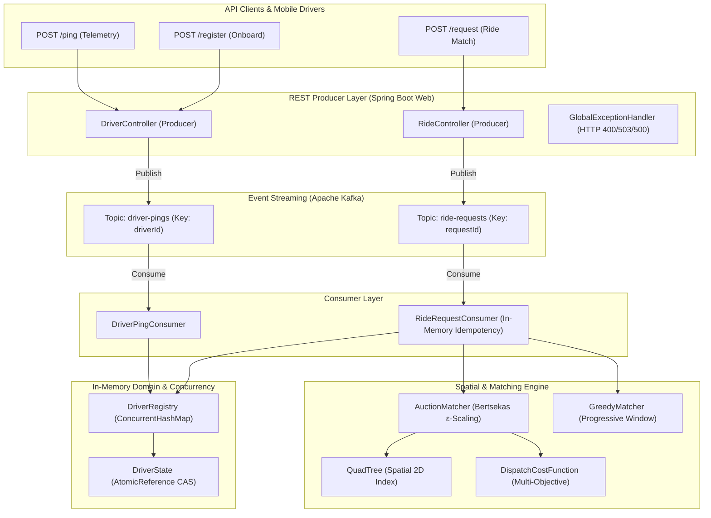

# Real-Time Ride Dispatch Matching Engine

A high-performance, concurrency-safe dispatch matching service implemented in Java 17 and Spring Boot. The system models a two-sided mobility platform with asynchronous event ingestion via Apache Kafka for high-throughput driver location telemetry and ride requests, maintains spatial indexes, computes multi-objective dispatch costs, and solves the driver-rider bipartite assignment problem while preventing double-booking races under extreme concurrency.

---

## 1. Problem Statement & Architecture

In real-time ride-hailing networks, dispatching rides involves four competing requirements:
1. **Asynchronous High-Throughput Ingestion:** Decoupling HTTP submission from matching computation using Kafka message queues, returning immediate `202 Accepted` receipts to clients.
2. **Low Latency & Spatial Indexing:** Finding candidate drivers near a pickup location without full fleet $O(N)$ linear scans.
3. **Global Assignment Optimality:** Minimizing deadhead travel time and balancing fleet distribution rather than greedily consuming suboptimal drivers.
4. **Strict Concurrency Safety:** Guaranteeing that under thousands of concurrent dispatch requests, no driver can ever be double-booked to two distinct ride requests (lost-update anomaly), and driver location telemetry updates never overwrite or clear active ride claims.

### System Architecture



---

## 2. Prerequisites & Build Commands

- **Java Development Kit (JDK):** Version 17 or higher
- **Build Tool:** Apache Maven 3.9+ (or the included `./mvnw` / `mvnw.cmd` wrapper)
- **Spring Boot:** 4.1.1
- **Apache Kafka:** Local broker or Docker container (see below)

### Local Kafka Startup

To run Kafka locally using KRaft mode:

```bash
# Start local Kafka broker (port 9092)
docker compose up -d kafka

# Check service status
docker compose ps
```

### Build & Run

```bash
# Compile and package application
./mvnw clean package

# Run the Spring Boot application locally (starts on http://localhost:8080)
./mvnw spring-boot:run
```

### Running Tests

Unit and integration tests run self-contained without requiring an external Kafka broker:

```bash
# Run full regression test suite (240 tests)
./mvnw clean test
```

---

## 3. Package & Module Structure

The project is structured under the root package `com.aagosh.dispatch`:

```
src/main/java/com/aagosh/dispatch/
├── DispatchApplication.java            # Spring Boot application bootstrap
├── api/                                # REST controllers (Kafka producers) and DTOs
│   ├── DriverController.java          # REST producer for /ping and /register (202 Accepted)
│   ├── RideController.java            # REST producer for /request (202 Accepted)
│   ├── DriverPingRequest.java         # Driver telemetry payload DTO
│   ├── DriverPingAcceptedResponse.java# Async 202 response for telemetry
│   ├── RideRequestDto.java            # Ride match request payload DTO
│   ├── RideAcceptedResponse.java      # Async 202 response for ride submission
│   ├── KafkaPublishException.java     # Exception mapped to HTTP 503 on broker failure
│   ├── ApiErrorResponse.java          # RFC 7807-style error payload DTO
│   └── GlobalExceptionHandler.java    # @RestControllerAdvice for validation & runtime exceptions
├── config/                             # Spring configuration and bean wiring
│   ├── DispatchConfig.java            # Fallback beans for Matcher and DispatchCostConfig
│   ├── KafkaConfig.java               # KafkaAdmin, ProducerFactory, ConsumerFactory, Topics
│   └── KafkaTopics.java               # Central constants for topic names
├── domain/                             # Core domain entities and concurrency primitives
│   ├── Driver.java                    # Driver record with ID, GeoPoint, and DriverState
│   ├── DriverRegistry.java            # Thread-safe in-memory registry (ConcurrentHashMap)
│   ├── DriverState.java               # AtomicReference-backed CAS claiming state machine
│   ├── GeoPoint.java                  # Validated coordinate record (lat/lon)
│   ├── MatchStatus.java               # Enum: AVAILABLE, CLAIMED, UNAVAILABLE
│   └── RideRequest.java               # Ride request domain record
├── matching/                           # Dispatch cost calculation and matching algorithms
│   ├── Assignment.java                # Immutable match pair (Driver, RideRequest, cost)
│   ├── AuctionMatcher.java            # Bertsekas' Auction Algorithm with ε-scaling
│   ├── DispatchCostConfig.java        # Immutable cost function weights and normalizers
│   ├── DispatchCostFunction.java      # Multi-objective normalized cost calculator
│   ├── GreedyMatcher.java             # Progressive-radius nearest-neighbor matcher
│   └── Matcher.java                   # Core matching strategy interface
├── messaging/                          # Kafka consumers
│   ├── DriverPingConsumer.java        # Consumes driver-pings, updates DriverRegistry
│   └── RideRequestConsumer.java       # Consumes ride-requests, matches via Matcher
└── spatial/                            # Spatial indexing and geometric primitives
    ├── BoundingBox.java               # Coordinate bounding box with intersection logic
    └── QuadTree.java                  # Hierarchical 2D spatial index for proximity pruning
```

---

## 4. End-to-End Request Flows

### Flow 1: Driver Ingestion & Telemetry (`POST /ping`)
1. Client submits driver ID and current GPS coordinates.
2. `DriverController` synchronously validates coordinates (`[-90, 90]`, `[-180, 180]`).
3. Payload is published to Kafka topic `driver-pings` using `driverId` as message key (preserving partition affinity).
4. On durable broker confirmation, HTTP `202 Accepted` is returned. If Kafka fails, HTTP `503 Service Unavailable` is returned.
5. `DriverPingConsumer` processes the event asynchronously:
   - Updates coordinates via atomic CAS loop on `AtomicReference<Driver>`.
   - Strictly preserves the authoritative `DriverState` instance, ensuring that telemetry never resets an active ride claim.

### Flow 2: Ride Dispatch Matching (`POST /request`)
1. Client submits pickup location and request ID.
2. `RideController` synchronously validates input and publishes to `ride-requests` with `requestId` as message key.
3. On broker confirmation, HTTP `202 Accepted` is returned.
4. `RideRequestConsumer` receives the event:
   - Checks the in-memory idempotency set (ignoring duplicate deliveries).
   - Snapshots registered drivers from `DriverRegistry`.
   - Invokes the configured `Matcher` (`AuctionMatcher` by default).
   - If an assignment is computed, claims the driver atomically via `DriverState.tryClaim(requestId)`.
   - Acknowledges the Kafka offset (`MANUAL_IMMEDIATE`).

---

## 5. Core Algorithms & Cost Model

### 5.1 Spatial Indexing (`QuadTree` & Geographic Distance)
- **Indexing:** A hierarchical 2D `QuadTree` indexes driver coordinates into quadrants (NW, NE, SW, SE).
- **Pruning:** Spatial range queries test bounding-box overlap before descending, avoiding full-fleet linear scans.
- **Distance Metric:** Great-circle geographic distance is computed using the spherical Haversine formula over WGS84 coordinates ($R = 6371.0088\text{ km}$).

### 5.2 Matching Strategies (`AuctionMatcher` vs. `GreedyMatcher`)
- **`AuctionMatcher` (Bertsekas Algorithm):**
  - Formulates the driver-request dispatch as an asymmetric assignment problem.
  - Drivers act as objects with economic "prices"; ride requests act as bidders computing net benefit $\text{value} - \text{price}$.
  - Uses $\varepsilon$-scaling to guarantee convergence to an almost-optimal global assignment while avoiding cycling in degenerate cost landscapes.
- **`GreedyMatcher`:**
  - Evaluates candidate drivers within expanding progressive spatial windows ($1\text{ km} \to 3\text{ km} \to 5\text{ km}$).
  - Assigns the single lowest-cost driver available.

### 5.3 Multi-Objective Cost Model (`DispatchCostFunction`)
The composite dispatch cost balances customer pickup time and supply preservation:

$$\text{Total Cost} = w_{\text{eta}} \cdot \text{Normalized ETA} + w_{\text{density}} \cdot \text{Normalized Density} + w_{\text{opportunity}} \cdot \text{Normalized Opportunity}$$

- **Normalized ETA:** Straight-line travel time ($\text{Haversine Distance} \div 60\text{ km/h}$), normalized over reference maximum ($30\text{ minutes}$) and clamped to $[0, 1]$.
- **Normalized Competition Density:** Count of unmatched ride pickup points within $1\text{ km}$ of the candidate driver, normalized by maximum density reference ($10\text{ requests}$) and clamped to $[0, 1]$.
- **Deferred Opportunity Cost:** Evaluates to neutral **`0.0`**. The current domain model deliberately omits trip destinations and pricing tiers. Fabricating artificial opportunity values would compromise dispatch validity. Setting $w_{\text{opportunity}} = 0.0$ is supported and recommended; $w_{\text{opportunity}} > 0$ is preserved for forward compatibility.

---

## 6. Concurrency Architecture & Delivery Semantics

### 6.1 Atomic Driver Claiming (CAS)
In high-demand scenarios, multiple ride requests simultaneously compete for the nearest available driver. The system enforces zero double-booking via `AtomicReference<State>` in `DriverState`:

```java
State current = state.get();
if (current.status() != MatchStatus.AVAILABLE) {
    return false;
}
State claimed = new State(MatchStatus.CLAIMED, requestId);
return state.compareAndSet(current, claimed);
```
Atomic compare-and-set (CAS) using Java's `AtomicReference` ensures that only one request wins the claim. Losing requests cleanly fail without partial writes.

### 6.2 Location Updates Preserving Driver State
When a driver's GPS device pings `/ping`, their location updates in memory:
- `DriverRegistry` updates the driver's location record using a CAS loop on `AtomicReference<Driver>`.
- The new `Driver` record reuses the existing `DriverState` reference.
- **Invariant:** A telemetry ping arriving while a driver is in the `CLAIMED` status **never** resets them back to `AVAILABLE`.

### 6.3 Kafka Delivery & Idempotency
- **At-Least-Once Delivery:** Kafka ensures messages are not lost, but redeliveries can occur on consumer crash or network partitions.
- **In-Memory Idempotency:** `RideRequestConsumer` maintains a thread-safe bounded `ConcurrentHashMap` set (capped at 10,000 entries) tracking processed `requestId`s. Duplicate events within the running application instance are acknowledged without re-executing matching.
- **Restart Limitation:** The in-memory idempotency set does not survive application restarts. Persistent, database-backed idempotency is deferred to Phase 5 Step 2.
- **No Event-Time Ordering:** In-memory CAS loops commit whichever coordinate arrives last. Cellular out-of-order delivery is addressed in subsequent phases via sequence numbers.

---

## 7. API Quick Start

### 7.1 Register Driver (`POST /register`)

```bash
curl -X POST http://localhost:8080/register \
  -H "Content-Type: application/json" \
  -d '{
    "driverId": "D101",
    "latitude": 17.385044,
    "longitude": 78.486671
  }'
```

**Response (`202 Accepted`):**
```json
{
  "driverId": "D101",
  "message": "Driver registration accepted and queued for processing"
}
```

### 7.2 Ingest Telemetry (`POST /ping`)

```bash
curl -X POST http://localhost:8080/ping \
  -H "Content-Type: application/json" \
  -d '{
    "driverId": "D101",
    "latitude": 17.389200,
    "longitude": 78.489100,
    "action": "AUTO"
  }'
```

**Response (`202 Accepted`):**
```json
{
  "driverId": "D101",
  "message": "Driver ping accepted and queued for processing"
}
```

### 7.3 Request Ride Match (`POST /request`)

```bash
curl -X POST http://localhost:8080/request \
  -H "Content-Type: application/json" \
  -d '{
    "requestId": "REQ-789",
    "latitude": 17.387000,
    "longitude": 78.488000
  }'
```

**Response (`202 Accepted`):**
```json
{
  "requestId": "REQ-789",
  "message": "Ride request accepted and queued for matching"
}
```

---

## 8. Testing & Verification

The project enforces comprehensive test coverage across unit, spatial, mathematical, concurrency, and REST/messaging layers.

```bash
./mvnw clean test
```

### Verified Test Suite Breakdown (240 Tests, 0 Failures)

| Test Class | Category | Test Count | Scope Verified |
| :--- | :--- | :---: | :--- |
| `QuadTreeTest` | Spatial | 16 | Quadrant subdivision, boundary conditions, range query pruning |
| `BoundingBoxTest` | Spatial | 10 | Bounding-box intersection, coordinate clamping, containment |
| `DispatchCostFunctionTest` | Mathematical | 61 | Normalization clamping, weights, edge cases, Haversine formula |
| `AuctionMatcherTest` | Algorithm | 40 | Bertsekas auction matching, ε-scaling, optimality comparisons |
| `GreedyMatcherTest` | Algorithm | 15 | Progressive radius windows, nearest-neighbor driver selection |
| `DispatchIntegrationTest` | Integration | 9 | End-to-end matching integration across cost model and spatial index |
| `DriverStateTest` | Concurrency | 2 | Single-thread state machine transitions |
| `DriverStateConcurrencyTest` | Concurrency | 20 | Multi-threaded CAS claims, state preservation during updates |
| `DriverRegistryTest` | Concurrency | 24 | Concurrent registrations, CAS location updates, snapshot isolation |
| `GeoPointTest` | Validation | 8 | Latitude/longitude bounds, NaN/infinite rejection, error messages |
| `DriverControllerTest` | Kafka Producer | 5 | Endpoints `/ping`, `/register`, topic routing, 202 Accepted, 503 error |
| `RideControllerTest` | Kafka Producer | 5 | Endpoint `/request`, `requestId` key partitioning, 202 Accepted, 503 error |
| `AdditionalControllerTest` | Controller / Concurrency | 3 | HTTP 500 error handling, 16-thread Greedy claims, concurrent `/ping` auto-fallback |
| `DriverPingConsumerTest` | Kafka Consumer | 6 | REGISTER/UPDATE/AUTO handling, claim state preservation, duplicate idempotency |
| `RideRequestConsumerTest` | Kafka Consumer | 6 | Matching delegation, atomic claim verification, in-memory duplicate filter |
| `DispatchConfigTest` | Spring Boot | 3 | Bean fallback resolution and custom Matcher bean override |
| `DispatchApplicationTests` | Smoke / Context | 7 | ApplicationContext initialization and bean discovery |
| **Total** | | **240** | **100% Passing (0 failures, 0 errors, 0 skipped)** |

---

## 9. Controlled Double-Booking Experiment

To demonstrate the concrete failure mode of non-atomic state updates, a reproducible concurrency experiment is maintained on the isolated branch `experiment/double-booking`.

- **Check-then-Set Vulnerability:** Demonstrates how non-atomic reads followed by writes cause two concurrent threads to both claim the same driver.
- **Atomic CAS Resolution:** Contrasts the vulnerability against production `DriverState.tryClaim` using Java's `AtomicReference`, proving 100% single-winner determinism under high concurrency.
- **Full Experiment Report:** See [docs/double-booking-experiment.md](docs/double-booking-experiment.md).

---

## 10. Architectural Stubs & Current Limitations

1. **Declared Architectural Services:** `docker-compose.yml` configures Apache Kafka for asynchronous telemetry and ride event streaming in Phase 5. PostgreSQL and Redis remain blueprint stubs for future milestones (database persistence and distributed caching).
2. **In-Memory Idempotency Lifecycle:** Bounded to 10,000 entries and single JVM lifecycle. Application restarts do not preserve processed request IDs. Durable persistence is planned for Phase 5 Step 2.
3. **Absence of Road Network Routing:** ETA estimates are derived using spherical Haversine straight-line distance at a nominal $60\text{ km/h}$. Turn penalties, one-way streets, and real-time traffic congestion are not modeled.
4. **Single-Node In-Memory Footprint:** The spatial index and driver registry reside entirely in JVM heap. Scaling across multiple replicas requires distributed spatial indexing (e.g., Uber H3 or Redis GEO) and distributed consensus.

---

## 11. Reference Documentation

- [REST API Specification](API_DOCUMENTATION.md) — Complete endpoint schemas, parameter matrices, error response examples, and Kafka event ingestion details.
- [Double-Booking Experiment Documentation](docs/double-booking-experiment.md) — In-depth concurrency race condition analysis and atomic CAS verification using Java's `AtomicReference`.
