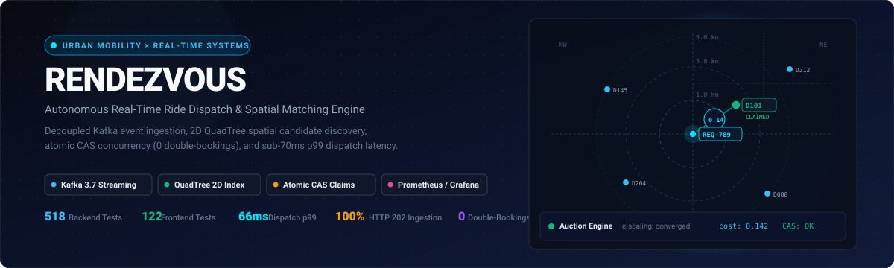
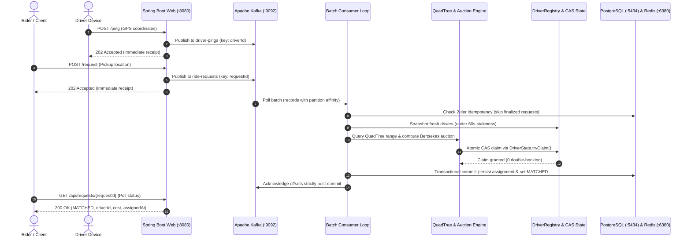

<p align="center">
  
</p>

# Rendezvous

> **Autonomous, concurrency-safe ride dispatch and spatial matching engine.**  
> Built with Java 17, Spring Boot, Apache Kafka, PostgreSQL, Redis, and React.

<p align="left">
  <a href="https://openjdk.org/projects/jdk/17/"></a>
  <a href="https://spring.io/projects/spring-boot"></a>
  <a href="https://kafka.apache.org/"></a>
  <a href="https://www.postgresql.org/"></a>
  <a href="https://redis.io/"></a>
  <a href="https://react.dev/"></a>
  <a href="https://vite.dev/"></a>
  <a href="#verified-engineering-statistics"></a>
  <a href="#verified-engineering-statistics"></a>
  <a href="#performance--benchmark-evidence"></a>
  
</p>

**Rendezvous** is a real-time mobility dispatch platform that decouples high-throughput ride request ingestion via Apache Kafka, indexes driver fleets in a hierarchical 2D QuadTree, computes multi-objective bipartite driver-rider matching in sub-70ms, and enforces zero double-bookings through atomic Compare-And-Set (CAS) state transitions backed by durable PostgreSQL persistence and Redis read caching.

---

## Navigation

- [Part A — Visual Showcase](#part-a--visual-showcase)
  - [Project at a Glance](#project-at-a-glance)
  - [What Rendezvous Does](#what-rendezvous-does)
  - [System Architecture](#system-architecture)
  - [Feature Showcase](#feature-showcase)
  - [Engineering Highlights](#engineering-highlights)
- [Part B — Technical Statistics & Engineering Evidence](#part-b--technical-statistics--engineering-evidence)
  - [Verified Technology Stack](#verified-technology-stack)
  - [Verified Engineering Statistics](#verified-engineering-statistics)
  - [Performance & Benchmark Evidence](#performance--benchmark-evidence)
  - [Engineering Decisions & Trade-Offs](#engineering-decisions--trade-offs)
  - [Testing, Setup & Verification](#testing-setup--verification)
  - [Architectural Status & Honest Limitations](#architectural-status--honest-limitations)
  - [Reference Documentation](#reference-documentation)

---

# Part A — Visual Showcase

## Project at a Glance

| Dimension | Architectural Implementation |
| :--- | :--- |
| **Domain Problem** | Low-latency urban ride dispatch balancing customer wait times, spatial supply distribution, and absolute concurrency safety under peak request spikes. |
| **Ingestion Pipeline** | Asynchronous Kafka event streaming returning immediate `202 Accepted` receipts; partitioned by `driverId` and `requestId`. |
| **Spatial Matching Core** | Hierarchical 2D `QuadTree` spatial index with progressive radius expansion ($1\text{ km} \to 3\text{ km} \to 5\text{ km}$) and Bertsekas Auction Algorithm with $\varepsilon$-scaling. |
| **Concurrency Safety** | In-memory `AtomicReference<State>` Compare-And-Set (CAS) state transitions; zero double-booking under extreme concurrency; GPS pings strictly preserve active ride claims. |
| **Durability & Caching** | PostgreSQL 16 (Flyway V1–V3) for durable terminal states; Redis 7 non-authoritative read cache with 30s TTL Lua script writes and automatic in-memory fallback. |
| **Automated Verification** | **640 total tests (100% passing)**: 518 backend unit/slice/integration tests across 33 test classes + 122 frontend Vitest tests across 11 test files. |
| **Measured Performance** | High-load benchmark (4,424 requests, 60 req/s sustained): **100% HTTP 202 acceptance**, **100% durable persistence**, **p95 dispatch 63 ms**, **p99 dispatch 66 ms**, zero timeouts. |
| **Active Topology** | 7 active network endpoints: Spring Boot (`:8080`), React/Vite (`:5173`), PostgreSQL (`:5434`), Redis (`:6380`), Kafka (`:9092`), Prometheus (`:9090`), Grafana (`:3000`). |

---

## What Rendezvous Does

In on-demand transportation networks, dispatch engines operate under competing operational constraints: they must ingest thousands of concurrent driver telemetry updates and rider pickup requests without blocking, discover proximate drivers without expensive $O(N)$ fleet scans, evaluate global dispatch cost, and guarantee that two riders can never claim the same driver simultaneously.

Rendezvous addresses this through a 6-stage asynchronous workflow:



1. **Ingest Events Asynchronously:** Clients submit driver pings and ride requests. The REST layer validates inputs and immediately returns `202 Accepted` receipts with Kafka broker confirmation, decoupling HTTP producers from matching computation.
2. **Stream Events via Apache Kafka:** Telemetry and ride events route through dedicated topics (`driver-pings` and `ride-requests`) using entity IDs as partition keys, preserving ordering and locality.
3. **Index & Discover Candidates Spatially:** A 2D `QuadTree` indexes driver coordinates into quadrants (NW, NE, SW, SE). Range pruning narrows candidate discovery to active search windows without full-fleet scans.
4. **Evaluate Multi-Objective Matching:** Candidate pairings are scored using a normalized composite cost function (ETA travel time + localized pickup competition density). Bertsekas' Auction Algorithm with $\varepsilon$-scaling resolves global assignment.
5. **Enforce Atomic Claiming & Durable Persistence:** The winning driver is claimed atomically in memory via `AtomicReference` CAS. The assignment and request state are written to PostgreSQL inside a single transaction. Kafka offsets commit strictly after database confirmation.
6. **Expose Trip Lifecycle & Real-Time Observability:** Clients poll trip status and advance through the trip lifecycle (`/en-route` $\to$ `/start` $\to$ `/complete` or `/cancel`), automatically releasing driver claims upon completion. System throughput, latency distributions, and contention rates are continuously monitored via Prometheus and Grafana.

> [!NOTE]
> **Implemented Scope vs. Future Capabilities:**  
> **Currently Implemented:** Decoupled Kafka streaming, 2D QuadTree spatial pruning, Bertsekas auction matching, atomic CAS claiming, two-tier idempotency, PostgreSQL durable state, non-authoritative Redis cache with 30s TTL Lua script, trip lifecycle transitions (`/en-route`), Prometheus scraping, Grafana dashboards, interactive React + MapLibre UI.  
> **Future Possibilities:** Graph-based road-network routing (OSRM/Valhalla), distributed spatial sharding (Uber H3/S2 geometry), multi-broker Kafka cluster, active Kafka poll-batch tuning, and dedicated Dead-Letter Topics (DLT).

---

## System Architecture

The following diagram illustrates the active runtime components, network boundaries, and asynchronous data flows across the system:

```mermaid
graph TD
    subgraph Clients["1. Clients & Interactive UI"]
        UI["React 19 + MapLibre GL (:5173)<br/>Interactive Map, Fleet Simulation & Control Panel"]
        Drivers["Mobile Driver Devices<br/>GPS Telemetry Stream"]
        Riders["Riders & API Clients<br/>Ride Dispatch Requests"]
    end

    subgraph Ingestion["2. REST Ingestion & Query Layer (Spring Boot :8080)"]
        DC["DriverController<br/>POST /ping, POST /register, GET /drivers/{id}/location"]
        RC["RideController<br/>POST /request"]
        RSC["RequestStatusController<br/>GET /api/requests/{id}, /api route aliases"]
        TC["TripController<br/>POST /api/trips/{id}/en-route, /start, /complete, /cancel"]
        TEL["TelemetryController<br/>GET /api/telemetry/batches"]
        ACT["Spring Boot Actuator<br/>GET /actuator/health, /actuator/prometheus"]
    end

    subgraph KafkaBrokers["3. Event Streaming Layer (Apache Kafka :9092)"]
        TP1["Topic: driver-pings<br/>Partition Key: driverId"]
        TP2["Topic: ride-requests<br/>Partition Key: requestId"]
    end

    subgraph Consumers["4. Messaging Consumer Layer"]
        DPC["DriverPingConsumer<br/>Asynchronous Telemetry Ingestion"]
        RRC["RideRequestConsumer<br/>Adaptive Batching, Idempotency & Matching Delegation"]
    end

    subgraph DomainCore["5. In-Memory Domain & Spatial Index"]
        DR["DriverRegistry<br/>ConcurrentHashMap (Thread-Safe Snapshot)"]
        DS["DriverState<br/>AtomicReference Compare-And-Set (CAS)"]
        QT["QuadTree<br/>Hierarchical 2D Spatial Pruning"]
        CF["DispatchCostFunction<br/>Multi-Objective (ETA + Competition Density)"]
        AM["AuctionMatcher<br/>Bertsekas Auction with ε-Scaling"]
        GM["GreedyMatcher<br/>Progressive Radius Nearest Neighbor"]
    end

    subgraph StorageLayer["6. Persistence & Caching Layer"]
        PG[("PostgreSQL 16 (:5434)<br/>ride_requests, assignments, trips<br/>Flyway Migrations V1–V3")]
        RD[("Redis 7 (:6380)<br/>driver:{id}:location Hash<br/>30s TTL Lua Script (Non-Authoritative)")]
    end

    subgraph ObservabilityLayer["7. Observability Infrastructure"]
        PROM["Prometheus (:9090)<br/>5s Actuator Pull via host.docker.internal"]
        GRAF["Grafana (:3000)<br/>21-Panel Operations Dashboard"]
    end

    %% Client to Ingestion Flows
    UI -->|HTTP /api/* Reverse Proxy| Ingestion
    Drivers -->|POST /ping| DC
    Riders -->|POST /request| RC

    %% Ingestion to Kafka
    DC -->|Publish Async| TP1
    RC -->|Publish Async| TP2

    %% Kafka to Consumers
    TP1 -->|Consume Event| DPC
    TP2 -->|Consume Batch| RRC

    %% Telemetry Consumer Flow
    DPC -->|Atomic Update| DR
    DPC -->|Conditional Write (30s TTL Lua)| RD

    %% Ride Consumer Matching Flow
    RRC -->|1. Check Finalized State| PG
    RRC -->|2. Snapshot Fresh Supply| DR
    RRC -->|3. Delegate Matching| AM
    AM -->|Spatial Prune| QT
    AM -->|Compute Cost| CF
    AM -.->|Fallback Strategy| GM
    RRC -->|4. Atomic CAS Claim| DS

    %% Persistence & Acknowledgment
    RRC -->|5. Transactional Commit| PG
    RRC -.->|6. Acknowledge Offset Strictly Post-Commit| TP2

    %% Query & Lifecycle Flows
    RSC -->|Read Request Status| PG
    TC -->|Update Lifecycle State Machine| PG
    TC -->|Release Claim on Finish| DS
    DC -->|Read-Through Cache| RD
    RD -.->|Fallback on Miss/Error| DR

    %% Observability Scrape
    ACT -->|Scrape Metrics| PROM
    PROM -->|Data Source| GRAF
```

---

## Feature Showcase

| Architectural Capability | Concrete Implementation | Verification & Testing Evidence |
| :--- | :--- | :--- |
| **Spatial Range Pruning** | Hierarchical 2D `QuadTree` subdivides geographic coordinates into quadrants (NW, NE, SW, SE). Bounding-box overlap tests prune spatial partitions before evaluating Haversine distance, eliminating $O(N)$ fleet scans. | `QuadTreeTest` (16 tests) and `BoundingBoxTest` (10 tests) verifying quadrant boundary splits, clamping, and query pruning. |
| **Atomic CAS Claiming** | `DriverState` wraps state transitions in `AtomicReference<State>`. A driver is claimed atomically via `state.compareAndSet(current, claimed)`. If multiple requests target the same driver concurrently, exactly one succeeds and losers retry or fallback cleanly. | `DriverStateConcurrencyTest` (20 tests) executing concurrent multi-threaded claim races with zero double-bookings. |
| **Claim-Preserving Telemetry** | When GPS pings arrive at `POST /ping`, `DriverRegistry` updates coordinates in-place using an atomic CAS loop on `AtomicReference<Driver>`. The authoritative `DriverState` reference is preserved, guaranteeing that telemetry updates never clear or overwrite an active claim. | `DriverPingConsumerTest` (16 tests) verifying `REGISTER`, `UPDATE`, and `AUTO` actions with claim preservation. |
| **Dual Matching Engines** | Configurable via `dispatch.matching.strategy`: `AuctionMatcher` (Bertsekas Auction Algorithm with $\varepsilon$-scaling for global economic optimization) and `GreedyMatcher` (progressive spatial expansion across 1 km, 3 km, and 5 km). | `AuctionMatcherTest` (40 tests) verifying convergence and economic optimality; `GreedyMatcherTest` (15 tests) verifying window radius progression. |
| **Two-Tier Idempotency** | **Tier 1 (In-Memory):** LRU cache (10,000 entries) and in-flight monitor filter redeliveries immediately. **Tier 2 (Database):** Batched pre-match query (`findFinalizedRequestIdsIn`) skips already-persisted requests before computing matches. | `RideRequestConsumerTest` (36 tests) and `AssignmentPersistenceServiceTest` (25 tests) verifying duplicate suppression. |
| **Non-Authoritative Location Cache** | Redis 7 stores `driver:{id}:location` hashes with a 30-second TTL written via conditional Lua scripts. Queries (`GET /drivers/{id}/location`) read from Redis to offload heap traffic, with seamless fallback to in-memory `DriverRegistry`. | `RedisLocationCacheTest` (18 tests) and `RedisLocationCacheIT` (12 Testcontainers tests) verifying Lua TTL writes and fallback behavior. |
| **Trip Lifecycle State Machine** | Deterministic state transitions (`DISPATCHED` $\to$ `EN_ROUTE` $\to$ `IN_PROGRESS` $\to$ `COMPLETED` / `CANCELLED`) exposed via `/en-route`, `/start`, `/complete`, and `/cancel`. Reaching terminal state automatically releases the driver's claim. | `TripControllerTest` (21 tests) and `TripLifecycleServiceTest` (19 tests) verifying valid transitions and invalid rejection. |
| **End-to-End Observability** | Centralized `DispatchMetrics` facade wraps Micrometer counters, timers, and gauges. Prometheus scrapes `/actuator/prometheus` every 5 seconds. Pre-provisioned Grafana dashboard visualizes 21 live panels. | Phase 9.5 benchmark evaluation verifying $+0.06\text{ ms}$ mean dispatch overhead under 60 req/s load with 21 active panels. |

---

## Engineering Highlights

### 1. Asynchronous Request-to-Dispatch Flow
In synchronous dispatch architectures, client HTTP connections block while the application queries spatial indexes, computes distance matrices, and executes database writes. Under sudden traffic spikes, thread pools exhaust and clients experience connection timeouts.

Rendezvous decouples this completely:
- When a ride request hits `POST /request`, the REST producer validates payload bounds and publishes the event to Kafka topic `ride-requests` with `requestId` as the message key.
- Upon durable broker confirmation, the client immediately receives HTTP `202 Accepted` with a tracking payload. Producer latency remains tightly bounded (mean $15.15\text{ ms}$, p99 $26\text{ ms}$ under peak load).
- The matching consumer loop pulls batches asynchronously, snapshots fresh driver supply, executes spatial discovery, claims the winning driver, and commits the outcome to PostgreSQL. Clients poll `GET /api/requests/{requestId}` to retrieve the terminal match outcome.

### 2. The Concurrency Problem Prevented by Atomic Driver Claiming
In real-time ride-hailing, high-demand events (concerts, airport arrivals, sporting events) trigger hundreds of pickup requests in identical geographic coordinates within milliseconds.

```
Thread A (Request 1) ───► Read Driver D101 (AVAILABLE) ──────────────────────────► Overwrite D101: CLAIMED
Thread B (Request 2) ────────► Read Driver D101 (AVAILABLE) ──► Overwrite D101: CLAIMED [DOUBLE BOOKING!]
```

Without synchronization, two concurrent requests both observe `Driver D101` as `AVAILABLE` and both write their claim. The driver receives two distinct passengers—a catastrophic lost-update anomaly.

Using database-level pessimistic locking (`SELECT ... FOR UPDATE`) introduces severe disk I/O bottlenecks and transaction serialization delays that cripple dispatch throughput. Rendezvous solves this in memory using Java's `AtomicReference<State>`:

```java
// DriverState.java: Atomic Compare-And-Set (CAS) State Transition
State current = state.get();
if (current.status() != MatchStatus.AVAILABLE) {
    return false; // Driver already claimed or unavailable
}
State claimed = new State(MatchStatus.CLAIMED, requestId);
return state.compareAndSet(current, claimed); // Guaranteed single-winner CAS
```

Under hardware-level CAS instructions, exactly one CPU thread succeeds in swapping the pointer from `AVAILABLE` to `CLAIMED`. Competing threads fail instantly and can either evaluate the next candidate driver or report unfulfilled demand.

> [!TIP]
> **Empirical Concurrency Verification:**  
> A dedicated race condition study comparing naive check-then-set against atomic CAS is documented in [docs/double-booking-experiment.md](docs/double-booking-experiment.md).

### 3. Durability, Idempotency & Claim Compensation
Because driver claiming occurs in memory via atomic CAS *before* the assignment is persisted to PostgreSQL, a database failure creates an architectural asymmetry: a driver is marked `CLAIMED` in memory, but no corresponding assignment exists in the database.

Rendezvous resolves this through **Ownership-Safe Driver Claim Compensation**:
- **Atomic CAS Release:** `DriverState.releaseClaim(requestId)` releases a driver back to `AVAILABLE` only if the driver's current claim matches the originating `requestId`. A delayed compensation attempt from an aborted request can never release a driver that was subsequently claimed by another request.
- **Ambiguous Failure Reconciliation:** If an exception occurs during persistence (such as a database connection timeout), the consumer queries PostgreSQL:
  - If the assignment committed with our driver, the event is acknowledged as an idempotent duplicate.
  - If a competing concurrent delivery won with a different driver, our driver's claim is released and the event is acknowledged.
  - If no assignment exists, rollback is confirmed: the driver claim is released, the in-flight reservation is cleared, and the exception propagates so Kafka's retry policy can act.
- **Strict Post-Commit Acknowledgement:** Kafka offset acknowledgement (`ack.acknowledge()`) occurs strictly after the database transaction has committed, guaranteeing at-least-once delivery without data loss.

### 4. Observability & Open-Loop Load Testing
Traditional load testing tools often suffer from **Coordinated Omission**: when the system under test experiences a latency spike, the load generator waits for responses before sending new requests, artificially deflating measured tail latency.

Rendezvous avoids this by using k6's open-loop `ramping-arrival-rate` executor:
- New virtual users arrive on a strict schedule regardless of whether previous requests have completed, faithfully modeling real-world passenger behavior.
- Ingestion latency (HTTP submission $\to$ `202 Accepted`) is measured independently from dispatch latency (HTTP submission $\to$ terminal status observed).
- Actuator Micrometer metrics are scraped by Prometheus every 5 seconds without synthetic load distortion, validating a negligible $+0.06\text{ ms}$ dispatch overhead under peak load.

### 5. An Honest Example of a Deferred Optimization: Kafka Poll Batching
Under sustained 60 req/s load generation, the observed average Kafka poll batch size was **$1.13$** (with a peak of 3), remaining below the architectural design target of **$\ge 10.0$**.

**Why this happens:**  
Spring Kafka's default consumer configuration operates with `fetch.min.bytes=1`. Under arrival rates of 60 req/s (one request every $\sim 16.6\text{ ms}$), the consumer thread polls the broker every 2–4 ms and immediately drains whatever records are available rather than pausing to accumulate larger batches.

**Why this matters & why it is deferred:**  
While larger batches would reduce database transaction overhead by consolidating inserts, aggressively tuning `fetch.min.bytes` and `fetch.max.wait.ms` introduces artificial latency buffering under low-to-medium traffic. Because the current implementation easily achieved p99 dispatch latency of $66\text{ ms}$ (well below the $250\text{ ms}$ SLA) with 100% persistence, consumer batch accumulation was explicitly documented and **deferred** to a future consumer-tuning milestone rather than prematurely optimized.

---

# Part B — Technical Statistics & Engineering Evidence

## Verified Technology Stack

| Technology Domain | Component | Exact Verified Version | Architectural Role |
| :--- | :--- | :---: | :--- |
| **Backend Runtime** | Java Development Kit (JDK) | `17.0.20` (OpenJDK HotSpot) | Platform runtime environment; full tiered compilation (C1 + C2 JIT active) |
| **Application Framework** | Spring Boot | `4.1.1` | Core REST APIs, dependency injection, application bootstrap, transaction management |
| **Event Streaming** | Apache Kafka | `3.7.0` (KRaft Mode) | Asynchronous event streaming for driver telemetry and ride requests |
| **Kafka Integration** | Spring Kafka | `3.3.0` | Container factories, manual offset acknowledgement, batch listener pipelines |
| **Durable Persistence** | PostgreSQL | `16` | Relational storage for ride requests, assignments, and trip lifecycles (host port `5434`) |
| **Database Migrations** | Flyway | `10.x` (Spring Boot BOM) | Automated, version-controlled schema migrations (`V1`, `V2`, `V3`) |
| **Location Caching** | Redis | `7` | Non-authoritative driver location cache with 30s TTL Lua script writes (host port `6380`) |
| **Frontend Framework** | React | `19.3.1` | Interactive dashboard, real-time map, fleet simulation, and dispatch panel |
| **Frontend Language** | TypeScript | `~6.0.2` | Strict compile-time type safety across UI models, hooks, and API services |
| **Build Tool & Bundler** | Vite | `^8.3.0` | Ultra-fast frontend development server and production bundler (host port `5173`) |
| **Geospatial Mapping** | MapLibre GL | `^6.14.0` | WebGL-accelerated vector mapping and real-time vehicle coordinate rendering |
| **Metrics Collector** | Prometheus | `v2.54.1` | Time-series metrics collection via 5-second Actuator scraping (host port `9090`) |
| **Metrics Visualization** | Grafana | `11.2.0` | Pre-provisioned 21-panel operations dashboard with anonymous viewer access (host port `3000`) |
| **Metrics Instrumentation** | Micrometer | Spring Boot BOM | Standardized application meters (counters, timers, gauges) via `DispatchMetrics` |
| **Load Testing** | Grafana k6 | `v0.50+` | Open-loop arrival rate performance benchmarking and database integrity validation |
| **Micro-Benchmarking** | OpenJDK JMH | `1.37` | Method-level algorithmic benchmarking for spatial and matching functions |

---

## Verified Engineering Statistics

The following table summarizes verified statistics derived directly from automated test execution, schema definitions, and official benchmark evidence records:

| Measurement Dimension | Verified Quantity | Measurement Context & Traceable Source | Evaluation Status |
| :--- | :---: | :--- | :---: |
| **Backend Test Suite** | **518 tests** | 33 test classes (465 unit/slice + 53 integration tests); Maven Surefire/Failsafe | **100% PASS** (0 failures, 0 errors, 0 skipped) |
| **Frontend Test Suite** | **122 tests** | 11 test files executed via Vitest in jsdom environment | **100% PASS** (122/122 passing) |
| **Total Automated Tests** | **640 tests** | Combined automated test coverage across full backend and frontend codebases | **100% PASS** |
| **Benchmark Workload** | **4,424 requests** | 85-second open-loop test ramping from 10 to 60 req/s sustained (`k6/high-load.js`) | **EXECUTED** |
| **HTTP Ingestion Availability** | **100.00%** | 4,424 / 4,424 requests accepted with HTTP `202 Accepted` receipts | **PASS** ($\ge 99.9\%$ SLA) |
| **Ingestion Latency (p95)** | **24 ms** | Client HTTP POST submission to HTTP `202 Accepted` broker confirmation | **PASS** ($< 40\text{ ms}$ SLA) |
| **Ingestion Latency (p99)** | **26 ms** | Client HTTP POST submission to HTTP `202 Accepted` broker confirmation | **PASS** ($< 80\text{ ms}$ SLA) |
| **Ingestion Latency (Mean)** | **15.15 ms** | Average producer acceptance latency across 4,424 requests | **NOMINAL** |
| **Dispatch Latency (p95)** | **63 ms** | Client HTTP POST submission to terminal `MATCHED` status observed | **PASS** ($< 150\text{ ms}$ SLA) |
| **Dispatch Latency (p99)** | **66 ms** | Client HTTP POST submission to terminal `MATCHED` status observed | **PASS** ($< 250\text{ ms}$ SLA) |
| **Dispatch Latency (Mean)** | **54.61 ms** | Average end-to-end matching and persistence latency across 4,424 requests | **NOMINAL** |
| **Dispatch Failures / Timeouts** | **0** | Zero dropped iterations, zero orphaned claims, zero HTTP 5xx errors | **PASS** ($0$ SLA) |
| **Durable Ingestion Persistence** | **100.00%** | Exactly $+4,424$ rows verified in PostgreSQL `ride_requests` and `assignments` | **PASS** ($100\%$ SLA) |
| **Fleet Integrity** | **0 double-bookings** | Exactly 0 double-booked drivers, 0 orphaned in-memory reservations | **PASS** ($0$ SLA) |
| **Grafana Dashboard Panels** | **21 panels** | Provisioned dashboard covering ingestion, matches, latency, batching, DB, cache | **VERIFIED** |
| **Average Kafka Poll Batch Size** | **1.13** (Peak: 3) | Measured consumer poll batch size under sustained 60 req/s arrival rate | **DEFERRED** (Target $\ge 10.0$) |

> [!NOTE]
> **Measurement Notice:**  
> Benchmark statistics reflect the empirical execution record documented in the [Phase 9 Observability Benchmark Report](docs/benchmarks/phase-9-observability-report.md) under full C2 JIT optimization. They serve as historical performance evidence for the specified test run and are not universal guarantees for arbitrary production topologies. The average poll-batch target of $\ge 10.0$ remains an explicitly deferred optimization.

---

## Performance & Benchmark Evidence

To evaluate the operational impact of real-time metrics collection, the system was benchmarked under identical high-load conditions before and after enabling the Phase 9 observability infrastructure.

### Comparative Benchmark Results (Phase 8 vs. Phase 9.5)

| Benchmark Metric | Phase 8 Baseline (No Scrape) | Phase 9.5 Observability (Active Scrape) | Architectural SLA | Measured Delta |
| :--- | :---: | :---: | :---: | :---: |
| **Total Requests Submitted** | 4,424 | 4,424 | — | Identical workload |
| **HTTP Acceptance Rate** | 100.00% (4,424 / 4,424) | 100.00% (4,424 / 4,424) | $\ge 99.9\%$ | $0.00\%$ delta |
| **Ingestion Latency (p95)** | $24\text{ ms}$ | $24\text{ ms}$ | $< 40\text{ ms}$ | $0\text{ ms}$ |
| **Ingestion Latency (p99)** | $28\text{ ms}$ | $26\text{ ms}$ | $< 80\text{ ms}$ | $-2\text{ ms}$ |
| **Ingestion Latency (Mean)** | $14.94\text{ ms}$ | $15.15\text{ ms}$ | — | $+0.21\text{ ms}$ overhead |
| **Dispatch Latency (p95)** | $64\text{ ms}$ | $63\text{ ms}$ | $< 150\text{ ms}$ | $-1\text{ ms}$ |
| **Dispatch Latency (p99)** | $70\text{ ms}$ | $66\text{ ms}$ | $< 250\text{ ms}$ | $-4\text{ ms}$ |
| **Dispatch Latency (Mean)** | $54.55\text{ ms}$ | $54.61\text{ ms}$ | — | $+0.06\text{ ms}$ overhead |
| **Durable Ingestion Persistence** | 100.00% (+4,424 rows) | 100.00% (+4,424 rows) | 100% | $100\%$ durable |
| **Dispatch Failures / Timeouts** | 0 | 0 | 0 | 0 errors |
| **Observed Mean Batch Size** | 1.12 | 1.13 (Peak: 3) | $\ge 10.0$ | Deferred target |
| **Active Prometheus Scraping** | Disabled | Enabled (every 5 seconds) | — | Live Actuator pull |
| **Active Grafana Panels** | 0 | 21 provisioned panels | — | Active monitoring |

### Methodology & Metric Definitions
- **Workload Profile (`k6/high-load.js`):** Open-loop arrival rate starting with a 15-second ramp (10 $\to$ 60 req/s), followed by a 60-second steady-state window at 60 req/s, and a 10-second drain window.
- **Ingestion Latency:** Measures the duration from client HTTP POST transmission to receipt of HTTP `202 Accepted` following Kafka broker confirmation.
- **Dispatch Latency:** Measures the total elapsed time from client HTTP POST transmission to terminal `MATCHED` status confirmation observed via polling or database state.
- **No Causal Speedup Claim:** Minor latency decreases at tail percentiles (e.g. p99 dispatch dropping from $70\text{ ms}$ to $66\text{ ms}$) fall within normal operating jitter and are not claimed as causal performance improvements. Rather, the empirical data confirms that real-time Micrometer instrumentation and continuous 5-second Prometheus scraping introduce negligible overhead ($+0.06\text{ ms}$ mean dispatch delta).

For complete technical logs, JIT configurations, and database query baselines, see:
- [Phase 8 Benchmark Evidence Report](docs/benchmarks/phase-8-alternative-a-report.md)
- [Phase 9 Observability Benchmark Report](docs/benchmarks/phase-9-observability-report.md)

---

## Engineering Decisions & Trade-Offs

| Technology Choice | Rationale & Alternatives Considered | Trade-Off Accepted |
| :--- | :--- | :--- |
| **Apache Kafka for Ingestion** | Decouples HTTP ingress from matching computation, buffering sudden demand spikes. Message keys (`driverId`, `requestId`) preserve partition affinity and ordering. *Alternatives considered:* Synchronous REST (fails under load spikes) and RabbitMQ (lacks native partition-key batch ordering). | Increased operational complexity (Zookeeper/KRaft coordination, offset commit semantics, and consumer group management). |
| **Hierarchical 2D QuadTree** | Indexes spatial driver coordinates in memory. Spatial bounding-box pruning reduces candidate discovery from an $O(N)$ full-fleet scan to $O(\log N)$ quadrant traversals. *Alternatives considered:* PostGIS queries (adds database network hops to inner matching loop) and linear array scans (poor scalability beyond $1,000$ drivers). | Requires single-JVM in-memory indexing; does not support distributed spatial partitioning across multiple instances without external sharding. |
| **Atomic Compare-And-Set (CAS)** | Manages driver claiming via `AtomicReference<State>` in `DriverState`. Concurrency races are resolved at the hardware CPU instruction level with zero lock contention. *Alternatives considered:* Pessimistic database row locks (`SELECT ... FOR UPDATE` introduces high latency) and synchronized Java methods (creates thread convoying). | Requires claim compensation logic to reconcile in-memory claims with database transaction rollbacks if persistence fails. |
| **PostgreSQL & Flyway for State** | Stores requests, assignments, and trip lifecycles with strict ACID guarantees, foreign keys, and unique constraints. Flyway migrations (`V1`–`V3`) maintain deterministic schema version control. *Alternatives considered:* Pure in-memory state (risks catastrophic data loss on crash). | Database writes represent the primary latency component in the dispatch pipeline (~40–50 ms of the 54 ms mean dispatch latency). |
| **Redis Non-Authoritative Cache** | Telemetry pings write to Redis hash key `driver:{id}:location` with a 30s TTL via conditional Lua scripts. Offloads high-frequency driver location lookups from the application heap. *Alternatives considered:* Querying PostgreSQL (saturates database with GPS pings) and authoritative Redis (risks cache inconsistency). | Redis operates strictly as a read-through cache; the in-memory `DriverRegistry` remains the authoritative source of truth for matching. |
| **Micrometer, Prometheus & Grafana** | Standardized metric collection via Spring Boot Actuator with pre-provisioned Grafana dashboards. Validated to introduce only $+0.06\text{ ms}$ dispatch overhead under peak load. *Alternatives considered:* Third-party APM agents (proprietary, heavier memory footprint) and ad-hoc log parsing. | Requires running two additional infrastructure containers (`prom/prometheus` and `grafana/grafana`) during local development. |

---

## Testing, Setup & Verification

### 1. Prerequisites
- **Java Development Kit (JDK):** Version 17+ (tested with Eclipse Adoptium OpenJDK 17.0.20)
- **Build Tool:** Apache Maven 3.9+ (or the included `./mvnw` / `mvnw.cmd` wrapper)
- **Node.js & npm:** Node.js 18+ (tested with v22.13.1) and npm 9+ (tested with 11.6.0)
- **Container Runtime:** Docker Engine and Docker Compose v2+
- **Load Testing Tool (Optional):** [k6](https://k6.io/) v0.50+ for benchmark scenarios

### 2. Infrastructure Services & Port Allocation

The platform components communicate across the following host and container ports:

| Service | Component | Host Port | Container Port | Protocol / Endpoints | Operational Purpose |
| :--- | :--- | :---: | :---: | :--- | :--- |
| **Backend** | Spring Boot (`dispatch`) | `8080` | `8080` (host) | HTTP (`/api/*`, `/actuator/*`) | REST ingestion, Kafka producers/consumers, spatial matching engine |
| **Frontend** | React + Vite (`rendezvous-frontend`) | `5173` | `5173` (host) | HTTP (`/`) | Interactive UI, MapLibre GL map, fleet simulation, reverse proxy `/api` |
| **PostgreSQL** | Database (`postgres:16`) | `5434` | `5432` | JDBC (`dispatch_db`) | Durable request status, assignments, and trip lifecycle tables (Flyway V1–V3) |
| **Redis** | Cache (`redis:7`) | `6380` | `6379` | RESP | Non-authoritative location cache (`driver:{id}:location`, 30s TTL, Lua script) |
| **Kafka** | Message Broker (`apache/kafka:3.7.0`) | `9092` | `9092` | PLAINTEXT | Asynchronous event streaming (`driver-pings`, `ride-requests`) |
| **Prometheus** | Metrics Collector (`prom/prometheus:v2.54.1`) | `9090` | `9090` | HTTP (`/`) | Scrapes backend `/actuator/prometheus` via `host.docker.internal:8080` every 5s |
| **Grafana** | Visualization UI (`grafana/grafana:11.2.0`) | `3000` | `3000` | HTTP (`/`) | Pre-provisioned 21-panel operations dashboard (anonymous viewer access enabled) |

> [!IMPORTANT]
> **PostgreSQL Host Port Mapping:**  
> The PostgreSQL container maps host port **`5434`** to container port `5432` to prevent conflicts with any local PostgreSQL instance running on default port `5432`. The backend connection URL is configured as `jdbc:postgresql://localhost:5434/dispatch_db`.

---

### 3. Local Setup & Execution Commands

#### Step 1: Environment Configuration
Create a local `.env` file from the provided `.env.example` template:
```bash
# Copy template environment file
cp .env.example .env
```
Open `.env` in an editor and set your desired local Grafana administrator password:
```env
GRAFANA_ADMIN_USER=admin
GRAFANA_ADMIN_PASSWORD=<change-me-to-a-secure-password>
```
*(Note: `.env` is ignored by Git and must never be committed).*

#### Step 2: Start Infrastructure Containers
```bash
# Start PostgreSQL, Redis, Kafka, Prometheus, and Grafana in detached mode
docker compose up -d

# Verify container health and port mappings
docker compose ps
```

#### Step 3: Build & Run the Spring Boot Backend
```bash
# Package the backend (skipping tests for quick startup)
./mvnw clean package -DskipTests

# Run the Spring Boot application (starts on http://localhost:8080)
./mvnw spring-boot:run
```
Upon startup, the application runs Flyway schema migrations (`V1`, `V2`, `V3`), connects to Redis, binds Kafka topics, and exposes Actuator probes.

#### Step 4: Run the Interactive Frontend
```bash
# Navigate to the frontend directory
cd frontend

# Install Node dependencies
npm install

# Start the Vite development server (starts on http://localhost:5173)
npm run dev
```
Navigate to **`http://localhost:5173`** to access the interactive map, request dispatch journeys, and monitor simulated fleets. The Vite dev server automatically proxies all `/api/*` calls to the Spring Boot backend at `http://localhost:8080`.

#### Step 5: Access Prometheus & Grafana Dashboards
- **Prometheus UI:** Navigate to **`http://localhost:9090`** to query live metrics (e.g. `dispatch_requests_total`, `dispatch_matches_total`).
- **Grafana Dashboard:** Navigate to **`http://localhost:3000`**. Anonymous viewer access is enabled by default. To edit panels, log in using username `admin` and your configured `GRAFANA_ADMIN_PASSWORD`. Open the pre-provisioned dashboard: **"Dispatch Matching Engine Overview"** (21 active panels).

#### Step 6: Quick Ingestion & Dispatch Verification (curl)
Verify end-to-end functionality across ingestion, matching, polling, and lifecycle transitions:

```bash
# 1. Ingest fresh driver location (returns HTTP 202 Accepted)
curl -X POST http://localhost:8080/ping \
  -H "Content-Type: application/json" \
  -d '{"driverId": "D101", "latitude": 17.385044, "longitude": 78.486671, "action": "AUTO"}'

# 2. Submit ride dispatch request (returns HTTP 202 Accepted)
curl -X POST http://localhost:8080/request \
  -H "Content-Type: application/json" \
  -d '{"requestId": "REQ-789", "latitude": 17.387000, "longitude": 78.488000}'

# 3. Poll terminal dispatch outcome (returns HTTP 200 OK with MATCHED status)
curl -X GET http://localhost:8080/api/requests/REQ-789

# 4. Advance trip lifecycle: transition to EN_ROUTE
curl -X POST http://localhost:8080/api/trips/REQ-789/en-route \
  -H "Content-Type: application/json" \
  -d '{"driverId": "D101"}'

# 5. Query cached driver location (reads from Redis with in-memory fallback)
curl -X GET http://localhost:8080/drivers/D101/location
```
*(For complete endpoint schemas, headers, error structures, and route aliases, see [API_DOCUMENTATION.md](API_DOCUMENTATION.md)).*

---

### 4. Automated Testing Commands

```bash
# Execute the complete backend test suite (518 tests across 33 test classes)
./mvnw clean test

# Execute PostgreSQL and Redis integration tests using Testcontainers
./mvnw test -Dtest=*IT

# Execute the complete frontend Vitest test suite (122 tests across 11 test files)
cd frontend && npm test

# Perform strict TypeScript type checking without emitting files
cd frontend && npm run typecheck
```

> [!NOTE]
> **Docker Auto-Detection in Integration Tests:**  
> Backend integration tests annotated with Testcontainers include environment auto-detection (`disabledWithoutDocker = true`). If Docker is absent, integration tests skip cleanly without failing the build.

---

### 5. Running Load Tests & Benchmarks (k6)

> [!WARNING]
> **Prerequisites for Benchmarking:**  
> Ensure Docker infrastructure and the Spring Boot backend are running under full C2 JIT compilation (`-XX:TieredStopAtLevel=1` must be absent). Do not run benchmarks against production databases.

```bash
# 1. Seed 200 fresh drivers into the in-memory registry and Redis
node scripts/seed-drivers.js --count 200

# 2. Execute low-load scenario (constant 3 req/s for 60 seconds)
k6 run k6/low-load.js

# 3. Execute high-load benchmark (ramping 10 -> 60 req/s sustained for 60 seconds)
k6 run k6/high-load.js
```

---

## Architectural Status & Honest Limitations

1. **Deferred Kafka Poll Batch Size ($\sim 1.13$ vs. $\ge 10.0$ Target):** Under sustained load testing, the observed average Kafka poll batch size was approximately **$1.13$** (with a peak of 3), remaining below the architectural design target of $\ge 10.0$. Because Spring Kafka defaults to `fetch.min.bytes=1`, it drains records immediately every 2–4 ms rather than buffering larger batches. Tuning `fetch.min.bytes` and `fetch.max.wait.ms` is explicitly documented as a **deferred optimization** to be addressed in future consumer-tuning milestones.
2. **Absence of Dedicated Dead-Letter Topic (DLT):** Exhausted Kafka consumer retries are logged and skipped via Spring Kafka's `DefaultErrorHandler`. Production deployments should configure a dedicated Dead-Letter Topic (DLT) with automated alerting and manual replay capabilities.
3. **Single-Broker Local Kafka Deployment:** The local Docker Compose setup deploys a single KRaft broker (`KAFKA_NODE_ID: 1`, partition replication factor 1). Production deployments require a multi-broker quorum across availability zones.
4. **Single-JVM In-Memory Spatial State:** `QuadTree` and `DriverRegistry` reside in JVM heap memory. Scaling across multiple application instances requires distributed spatial partitioning (e.g., Uber H3 or Redis GEO) and distributed consensus.
5. **Spherical Haversine Routing:** Travel times and ETAs use spherical Haversine straight-line distance at a nominal $60\text{ km/h}$. Turn penalties, one-way restrictions, and real-time road congestion are not modeled.
6. **Neutral Opportunity Cost:** The multi-objective opportunity cost term in `DispatchCostFunction` evaluates to neutral `0.0` until trip pricing and destination tiers are introduced into the domain model.

---

## Reference Documentation

- [REST API Specification](API_DOCUMENTATION.md) — Comprehensive endpoint schemas, headers, request/response payloads, error structures, trip lifecycle endpoints (`/en-route`), and route aliases.
- [Phase 8 Benchmark Evidence Report](docs/benchmarks/phase-8-alternative-a-report.md) — High-load k6 evaluation, Alternative A batched lookup analysis, latency percentiles, and batching metrics.
- [Phase 9 Observability Benchmark Report](docs/benchmarks/phase-9-observability-report.md) — Empirical assessment of Prometheus/Grafana observability overhead under 60 req/s load, latency comparison, and live dashboard validation.
- [Controlled Double-Booking Concurrency Experiment](docs/double-booking-experiment.md) — In-depth concurrency race condition analysis and atomic CAS verification using Java's `AtomicReference`.
