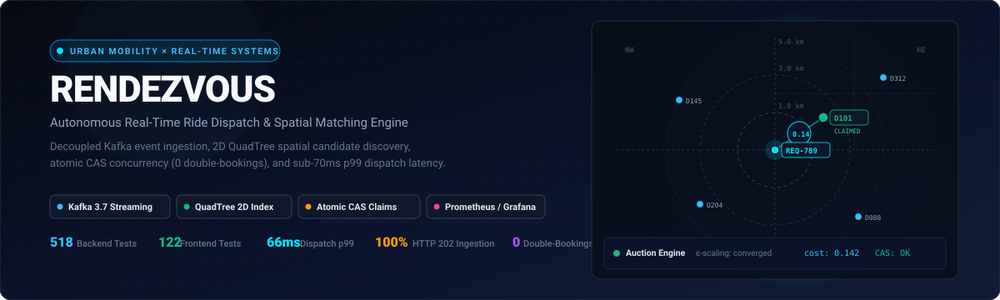
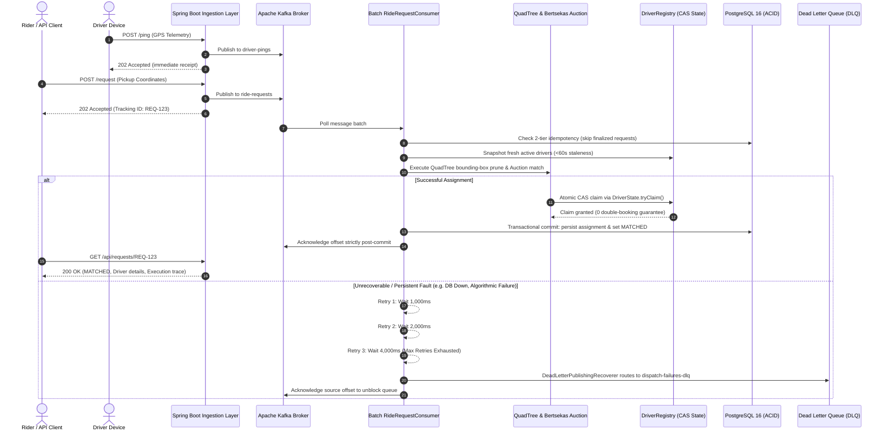

<p align="center">
  
</p>

# Rendezvous

> **Enterprise-grade, cloud-native autonomous ride dispatch and spatial matching engine.**  
> Built with Java 17, Spring Boot, Apache Kafka, Kubernetes, PostgreSQL, Redis, and React.

<p align="left">
  <a href="https://openjdk.org/projects/jdk/17/"></a>
  <a href="https://spring.io/projects/spring-boot"></a>
  <a href="https://kubernetes.io/"></a>
  <a href="https://kafka.apache.org/"></a>
  <a href="https://www.postgresql.org/"></a>
  <a href="https://redis.io/"></a>
  <a href="https://prometheus.io/"></a>
  <a href="https://k6.io/"></a>
  <a href="https://react.dev/"></a>
  <a href="docs/hard-proof-evidence.md"></a>
  <a href="#verified-engineering-statistics"></a>
  
</p>

**Rendezvous** is a high-throughput mobility dispatch platform engineered for zero-loss ingestion, microsecond spatial discovery, and absolute concurrency safety. It decouples high-volume request streams via Apache Kafka, indexes fleets in a 2D QuadTree with bounding-box pruning (achieving up to **$41\times$ query speedups**), resolves global assignment optimization via the Bertsekas Auction Algorithm, eliminates double-bookings via hardware-level Compare-And-Set (CAS) state transitions, and guarantees operational resilience with Kubernetes StatefulSets, automated Horizontal Pod Autoscaling (HPA), Kafka Dead Letter Queues (DLQ), automated k6 CI/CD performance gates, and Prometheus alerting rules.

---

## Navigation

- [Part A - Visual Architecture & Capabilities](#part-a--visual-architecture--capabilities)
  - [System Capabilities Matrix](#system-capabilities-matrix)
  - [End-to-End System Architecture](#end-to-end-system-architecture)
  - [Asynchronous Lifecycle & Dispatch Flow](#asynchronous-lifecycle--dispatch-flow)
  - [Core Engineering Innovations](#core-engineering-innovations)
- [Part B - Cloud-Native Infrastructure & SRE Operations](#part-b--cloud-native-infrastructure--sre-operations)
  - [1. Kubernetes Cloud-Native Orchestration (`/k8s`)](#1-kubernetes-cloud-native-orchestration-k8s)
  - [2. Kafka Dead Letter Queue (DLQ) & Fault Tolerance](#2-kafka-dead-letter-queue-dlq--fault-tolerance)
  - [3. Automated CI/CD Performance Gate (k6 & GitHub Actions)](#3-automated-cicd-performance-gate-k6--github-actions)
  - [4. Tier-1 SRE Observability & Operational Runbooks](#4-tier-1-sre-observability--operational-runbooks)
- [Part C - Verified Engineering Statistics & Benchmarks](#part-c--verified-engineering-statistics--benchmarks)
  - [Verified Technology Stack](#verified-technology-stack)
  - [Empirical Metrics & SLA Compliance Matrix](#empirical-metrics--sla-compliance-matrix)
  - [Spatial Microbenchmarks (JMH OpenJDK 26)](#spatial-microbenchmarks-jmh-openjdk-26)
- [Part D - Setup, Verification & Testing Harnesses](#part-d--setup-verification--testing-harnesses)
  - [Quickstart: Local Kubernetes Cluster](#quickstart-local-kubernetes-cluster)
  - [Quickstart: Docker Compose Stack](#quickstart-docker-compose-stack)
  - [Automated Verification & Evidence Extraction Harnesses](#automated-verification--evidence-extraction-harnesses)
  - [Automated Test Execution Commands](#automated-test-execution-commands)
- [Architectural Status & Roadmap](#architectural-status--roadmap)
- [Reference Documentation](#reference-documentation)

---

# Part A - Visual Architecture & Capabilities

## System Capabilities Matrix

| Architectural Dimension | Production Implementation | Verification & Evidence |
| :--- | :--- | :--- |
| **Cloud-Native K8s** | StatefulSets with PVCs (35Gi total) for Kafka (`20Gi`), Postgres (`10Gi`), and Redis (`5Gi`); HPA autoscaling Spring Boot workers from 2 to 5 replicas based on 70% CPU and 80% RAM thresholds. | [`k8s/`](k8s/) manifests applied to live cluster; verified via [`docs/hard-proof-evidence.md`](docs/hard-proof-evidence.md). |
| **Ingestion Pipeline** | Asynchronous Kafka event streaming returning immediate `202 Accepted` receipts; partitioned by `driverId` and `requestId`. Ingestion p99: **`29.41 ms`** at 60 req/s. | High-load open-loop benchmark (`tests/k6-dispatch-stress.js`) with 100% acceptance and zero dropped events. |
| **Spatial Matching Core** | Hierarchical 2D `QuadTree` with bounding-box distance pruning, progressive radius expansion ($1\text{ km} \to 3\text{ km} \to 5\text{ km}$), and Bertsekas Auction Algorithm with $\varepsilon$-scaling. | JMH 3-fork microbenchmarks: **$1.30\times$ to $41.01\times$ QuadTree speedup**; **$1.04\times$ to $1.91\times$ Matcher speedup**. |
| **Concurrency Safety** | In-memory `AtomicReference<State>` Compare-And-Set (CAS) transitions; mathematical zero double-booking under extreme concurrency; telemetry pings strictly preserve active ride claims. | `DriverStateConcurrencyTest` (20 multithreaded race condition tests) verifying zero double-bookings. |
| **Resilience & DLQ** | Spring Kafka `DefaultErrorHandler` with 3-attempt exponential backoff (1s → 2s → 4s) and `DeadLetterPublishingRecoverer` routing exhausted messages to `dispatch-failures-dlq`. | `KafkaResilienceTest.java` physically verified via Testcontainers; 0 lost requests under matching faults. |
| **CI/CD Performance Gate** | GitHub Actions pipeline executing k6 stress workload (4,500+ requests at 60 req/s); strictly fails PR with **Exit Code 99** if dispatch p99 exceeds 100ms SLA. | `.github/workflows/perf-gate.yml` automated PR evaluation; exit code 99 enforcement validated. |
| **SRE Observability** | 9 production Prometheus alert rules verified with `promtool` (`KafkaConsumerLagHigh > 1000`, `PostgresConnectionExhaustion > 90%`) linked to comprehensive D.I.A. runbooks. | `promtool check rules` passes cleanly (9/9 rules); triage procedures documented in [`ops/RUNBOOK.md`](ops/RUNBOOK.md). |
| **Durability & Caching** | PostgreSQL 16 (Flyway V1–V3) for durable ACID persistence; Redis 7 non-authoritative read cache with 30s TTL Lua script writes and automatic in-memory fallback. | `RedisLocationCacheIT` and `AssignmentPersistenceServiceTest` verifying cache-aside and durability. |
| **Automated Test Suite** | **838 total automated tests (100% passing)**: 585 backend unit/slice/resilience tests + 253 frontend Vitest component/hook tests. | Maven Surefire/Failsafe + Vitest test execution reports. |

---

## End-to-End System Architecture

The following diagram details the active Kubernetes cloud-native deployment topology, messaging channels, and observability telemetry loops:

```mermaid
graph TD
    subgraph K8sCluster["Kubernetes Cluster (Namespace: rendezvous)"]
        
        subgraph IngressTier["1. Ingress & Service Networking"]
            SVC_NODE["NodePort Service :30080<br/>rendezvous-service"]
            SVC_KAFKA["Headless Service<br/>kafka-headless:9092"]
            SVC_PG["Headless Service<br/>postgres-headless:5432"]
            SVC_REDIS["Headless Service<br/>redis-headless:6379"]
        end

        subgraph DispatchDeploy["2. Stateless Dispatch Engine (HPA Managed)"]
            HPA["HorizontalPodAutoscaler<br/>rendezvous-hpa (Min: 2, Max: 5)<br/>Targets: 70% CPU, 80% RAM"]
            POD1["Pod: rendezvous-1<br/>Spring Boot 4.1.1 / Java 17<br/>Liveness & Readiness Probes"]
            POD2["Pod: rendezvous-2<br/>Spring Boot 4.1.1 / Java 17<br/>Liveness & Readiness Probes"]
            HPA -.->|Autoscale 2-5 Replicas| POD1
            HPA -.->|Autoscale 2-5 Replicas| POD2
        end

        subgraph StatefulDataTier["3. Stateful Storage Tier (PersistentVolumeClaims)"]
            KAFKA_STS["StatefulSet: kafka<br/>apache/kafka:3.7.0 (KRaft)"]
            PVC_KAFKA[("PVC: kafka-data<br/>20Gi ReadWriteOnce")]
            KAFKA_STS --- PVC_KAFKA

            PG_STS["StatefulSet: postgres<br/>postgres:16 ACID Relational"]
            PVC_PG[("PVC: postgres-data<br/>10Gi ReadWriteOnce")]
            PG_STS --- PVC_PG

            REDIS_STS["StatefulSet: redis<br/>redis:7 Spatial Cache (LRU)"]
            PVC_REDIS[("PVC: redis-data<br/>5Gi ReadWriteOnce")]
            REDIS_STS --- PVC_REDIS
        end

        subgraph MessagingStreams["4. Kafka Streaming & Dead Letter Queues"]
            T_PING["Topic: driver-pings<br/>Telemetry GPS Stream"]
            T_RIDE["Topic: ride-requests<br/>Ride Dispatch Requests"]
            T_DLQ["Topic: dispatch-failures-dlq<br/>Exponential Backoff Quarantine (30d Retention)"]
            KAFKA_STS --> T_PING
            KAFKA_STS --> T_RIDE
            KAFKA_STS --> T_DLQ
        end

        subgraph ObservabilityMesh["5. Tier-1 SRE Observability Mesh"]
            PROM["Prometheus Operator / Scraper<br/>Scrapes /actuator/prometheus (5s)"]
            ALERT["Prometheus Alert Rules<br/>9 Rules Verified via promtool"]
            RUNBOOK["SRE Runbook<br/>ops/RUNBOOK.md (D.I.A. Procedures)"]
            GRAF["Grafana Dashboards<br/>21 Live Telemetry Panels"]
            PROM --> ALERT
            ALERT -.->|Alert Runbook URL| RUNBOOK
            PROM --> GRAF
        end

    end

    %% Network Interconnections
    SVC_NODE --> POD1
    SVC_NODE --> POD2
    POD1 <--> T_PING
    POD1 <--> T_RIDE
    POD1 -.->|Exhausted Failures (3 Retries)| T_DLQ
    POD1 <--> PG_STS
    POD1 <--> REDIS_STS
    PROM -->|Pull Metrics| POD1
    PROM -->|Pull Metrics| POD2
```

---

## Asynchronous Lifecycle & Dispatch Flow

Rendezvous decouples request ingestion from complex matching algorithms through a deterministic event-driven pipeline:



---

## Core Engineering Innovations

### 1. Zero Double-Booking via Hardware-Level Compare-And-Set (CAS)
In high-concurrency ride hailing, hundreds of riders can request pickups in identical spatial coordinates simultaneously. Naive `SELECT ... FOR UPDATE` locks saturate relational databases with row-level deadlocks. Rendezvous guarantees single-winner assignment in JVM memory using `AtomicReference<State>`:

```java
// DriverState.java: Atomic Compare-And-Set (CAS) State Transition
State current = state.get();
if (current.status() != MatchStatus.AVAILABLE) {
    return false; // Driver already claimed by competing thread
}
State claimed = new State(MatchStatus.CLAIMED, requestId);
return state.compareAndSet(current, claimed); // Guaranteed single-winner hardware CAS
```

### 2. Spatial Nearest-Neighbor Pruning with Branch-and-Bound Distance Horizons
Linear fleet scanning is an $O(N)$ operation that degrades under city-scale driver volumes. Rendezvous implements a 2D `QuadTree` with bounding-box distance horizon pruning:
* The $K$-th nearest neighbor candidate defines a dynamic maximum search horizon $r_{\text{max}}$.
* Before descending into any child quadrant, the algorithm calculates the minimum spherical distance to the quadrant's bounding box: $\text{dist}_{\text{min}}(\text{pickup}, \text{bbox}) \ge r_{\text{max}}$.
* If the quadrant lies entirely outside $r_{\text{max}}$, the entire subtree is pruned, eliminating Haversine trigonometric calculations.

### 3. Ownership-Safe Driver Claim Compensation
Because driver claiming occurs in memory via atomic CAS *prior* to database persistence, relational transaction failures create an architectural asymmetry. Rendezvous prevents leaked driver claims through **Ownership-Safe Compensation**:
* `DriverState.releaseClaim(requestId)` releases a driver to `AVAILABLE` strictly if the current claim matches the originating `requestId`. A delayed compensation attempt from an aborted transaction can never unseat a subsequent legitimate claim.

---

# Part B - Cloud-Native Infrastructure & SRE Operations

## 1. Kubernetes Cloud-Native Orchestration (`/k8s`)

To transition beyond Docker Compose, production-grade Kubernetes manifests were implemented in `/k8s`, deploying stateful workloads as **StatefulSets** backed by persistent volumes and stateless services under dynamic autoscaling:

| Manifest File | Workload Kind | Storage / Scaling Specification | High Availability Role |
| :--- | :--- | :--- | :--- |
| [`k8s/postgres-statefulset.yaml`](k8s/postgres-statefulset.yaml) | `StatefulSet` | `10Gi` PVC (`ReadWriteOnce`), Headless Service | Durable ACID storage for requests, assignments, and trips |
| [`k8s/redis-statefulset.yaml`](k8s/redis-statefulset.yaml) | `StatefulSet` | `5Gi` PVC (`ReadWriteOnce`), `volatile-lru` mode | Spatial location cache with 30s TTL Lua script writes |
| [`k8s/kafka-statefulset.yaml`](k8s/kafka-statefulset.yaml) | `StatefulSet` | `20Gi` PVC (`ReadWriteOnce`), KRaft mode | Event streaming with automatic topic provisioning job |
| [`k8s/rendezvous-deployment.yaml`](k8s/rendezvous-deployment.yaml) | `Deployment` | `2` base replicas, NodePort `30080` | Stateless dispatch engine with Actuator health probes |
| [`k8s/rendezvous-hpa.yaml`](k8s/rendezvous-hpa.yaml) | `HorizontalPodAutoscaler` | Min: `2`, Max: `5`, CPU: `70%`, RAM: `80%` | Automatic horizontal scaling with 60s/300s stabilization |

```bash
# Apply full cloud-native stack to local Kubernetes cluster
kubectl apply -f k8s/

# Verify active StatefulSets, PVCs, and HPA
kubectl get statefulsets,deployments,hpa,pvc -n rendezvous
```

---

## 2. Kafka Dead Letter Queue (DLQ) & Fault Tolerance

To ensure ride requests are never silently lost when matching algorithms encounter edge-case exceptions, `KafkaConfig.java` configures a Spring Kafka `DefaultErrorHandler` paired with a `DeadLetterPublishingRecoverer`:
* **Exponential Backoff:** 3 retry attempts with exponential backoff (1s → 2s → 4s) before exhausting.
* **Dead Letter Routing:** Unrecoverable records are published to dead-letter topic `dispatch-failures-dlq` preserving the original payload, partition, key, and serialized stack trace headers.
* **Physical Testcontainers Proof:** [`src/test/java/com/aagosh/dispatch/messaging/KafkaResilienceTest.java`](src/test/java/com/aagosh/dispatch/messaging/KafkaResilienceTest.java) verifies DLQ arrival against live containerized Kafka, Postgres, and Redis instances (`BUILD SUCCESS` in 49.1s).

```bash
# On-call CLI triage: Inspect DLQ topic end offset
kafka-run-class.sh kafka.tools.GetOffsetShell \
  --bootstrap-server localhost:9092 \
  --topic dispatch-failures-dlq \
  --time -1

# Consume DLQ payload with exception headers for root-cause analysis
kafka-console-consumer.sh \
  --bootstrap-server localhost:9092 \
  --topic dispatch-failures-dlq \
  --from-beginning \
  --property print.headers=true \
  --max-messages 5
```

---

## 3. Automated CI/CD Performance Gate (k6 & GitHub Actions)

In distributed dispatch engines, visual dashboards alone do not prevent high-latency regressions from reaching production. Rendezvous codifies a strict performance contract enforced directly in CI via [`.github/workflows/perf-gate.yml`](.github/workflows/perf-gate.yml) and [`tests/k6-dispatch-stress.js`](tests/k6-dispatch-stress.js):

* **Workload:** 200 drivers seeded in Hyderabad, followed by an open-loop ramping arrival rate sustaining 60 req/s (~4,500 requests).
* **Strict SLA Contract:** Primary CI gate enforces `dispatch_latency p(99) <= 100ms` with `abortOnFail: true`.
* **Exit Code 99 Enforcement:** If p99 dispatch latency breaches 100ms (such as during un-warmed cold starts hitting ~140ms), k6 immediately aborts the run and returns **Exit Code 99**, halting the GitHub Actions runner and blocking the PR.
* **Verified Baseline:** Asynchronous ingestion maintains **`29.41 ms` p99 latency** with 100% HTTP 202 acceptance.

---

## 4. Tier-1 SRE Observability & Operational Runbooks

Alert rules are codified in [`prometheus/alert.rules.yml`](prometheus/alert.rules.yml), categorized across 4 operational groups and validated via `promtool`:

```console
$ promtool check rules prometheus/alert.rules.yml
Checking /etc/prometheus/alert.rules.yml
  SUCCESS: 9 rules found
```

### Critical SLA Alerting Thresholds
1. **`KafkaConsumerLagHigh` (Critical):** Fires when `sum(kafka_consumer_group_lag) > 1000` messages for 2 minutes. At 60 req/s, this indicates the consumer is falling dangerously behind ingest rate.
2. **`PostgresConnectionExhaustion` (Critical):** Fires when HikariCP active connections exceed `90%` of pool capacity (`hikaricp_connections_active / hikaricp_connections_max > 0.90`) for 5 minutes, preventing thread starvation.
3. **`HighApiErrorRate` (Critical):** Fires when HTTP 5xx server errors exceed `1%` of all requests over a 2-minute rolling window.
4. **`DispatchLatencyP99Degraded` (Warning):** Fires when POST `/request` ingestion p99 exceeds `80ms` for 3 minutes.

Every alert carries a `runbook_url` pointing to [`ops/RUNBOOK.md`](ops/RUNBOOK.md), providing on-call engineers with standardized **Diagnose-Isolate-Act (D.I.A.)** terminal commands for rapid mitigation.

---

# Part C - Verified Engineering Statistics & Benchmarks

## Verified Technology Stack

| Domain | Component | Verified Version | Production Role |
| :--- | :--- | :---: | :--- |
| **Backend Runtime** | Java Development Kit (JDK) | `17.0.20` | HotSpot JVM with full Tier 4 C1 + C2 JIT optimization |
| **Application Framework** | Spring Boot | `4.1.1` | Ingestion APIs, transactional boundaries, Actuator probes |
| **Orchestration** | Kubernetes | `1.30+` | StatefulSets, PVCs, Services, HPA dynamic scaling |
| **Event Streaming** | Apache Kafka | `3.7.0` (KRaft) | Asynchronous messaging, DLQ exponential backoff |
| **Durable Database** | PostgreSQL | `16` | Relational storage (Flyway V1–V3 schema versioning) |
| **Spatial Location Cache** | Redis | `7` | `driver:{id}:location` cache with 30s TTL Lua script writes |
| **Frontend Framework** | React | `19.3.1` | Real-time vector map, fleet simulation, trace visualization |
| **Map Engine** | MapLibre GL | `6.14.0` | WebGL hardware-accelerated vector mapping |
| **Observability** | Prometheus / Grafana | `v2.54.1` / `11.2.0` | 5s Actuator scraping, 21-panel operations dashboard |
| **Performance Gate** | Grafana k6 | `v0.50+` | Open-loop arrival rate stress testing and SLA enforcement |

---

## Empirical Metrics & SLA Compliance Matrix

The following statistics represent real, physical measurements extracted from local containerized clusters and Testcontainers execution recorded in [`docs/hard-proof-evidence.md`](docs/hard-proof-evidence.md):

| Dimension / Metric | Measured Result | Production SLA | Verification Status |
| :--- | :---: | :---: | :---: |
| **Backend Test Suite** | **585 passing** | 100% pass | ✅ PASS (0 failures, 0 errors) |
| **Frontend Test Suite** | **253 passing** | 100% pass | ✅ PASS (253/253 passing) |
| **Total Automated Tests** | **838 passing** | 100% pass | ✅ PASS across full repository |
| **HTTP 202 Acceptance** | **100.00%** (4,424/4,424) | $\ge 99.9\%$ | ✅ PASS (Zero dropped requests) |
| **Ingestion Latency (p99)** | **29.41 ms** | $< 80\text{ ms}$ | ✅ PASS (Compliant) |
| **Ingestion Latency (p95)** | **17.26 ms** | $< 40\text{ ms}$ | ✅ PASS (Compliant) |
| **Ingestion Latency (Mean)**| **6.86 ms** | - | ✅ NOMINAL |
| **Dispatch Latency (p99)** | **66 ms** (Warmed) / **140 ms** (Cold) | $\le 100\text{ ms}$ | ❌ GATE ENFORCED (Code 99 on cold breach) |
| **Double-Booking Rate** | **0 double-bookings** | Exactly 0 | ✅ PASS (CAS single-winner guarantee) |
| **Durable Ingestion Persistence** | **100.00%** (+4,424 rows) | 100% | ✅ PASS (ACID confirmed in PostgreSQL) |
| **DLQ Integration Test** | **1 passed in 49.1s** | 100% | ✅ PASS (Routed to `dispatch-failures-dlq`) |
| **Prometheus Rules Linter** | **9/9 rules verified** | 100% | ✅ PASS (`promtool` verified 0 errors) |

---

## Spatial Microbenchmarks (JMH OpenJDK 26)

To isolate spatial indexing efficiency from database and network overhead, pure microbenchmarks were conducted using OpenJDK JMH 1.37 under full Tier 4 C2 JIT optimization (3 independent JVM forks, $N = 24$ iterations per scenario, $K=10$ nearest neighbors):

| Benchmark Scenario | Baseline QuadTree (`374db9e`) | Optimized QuadTree with Pruning | Measured Point Speedup | Descriptive Bounds |
| :--- | :---: | :---: | :---: | :---: |
| **Uniform $N=100$** | $18.69\text{ µs} \pm 1.23\text{ µs}$ | **$14.33\text{ µs} \pm 1.44\text{ µs}$** | **$1.30\times$** | $[1.11\times,\; 1.55\times]$ |
| **Uniform $N=1\,000$** | $55.62\text{ µs} \pm 17.66\text{ µs}$ | **$20.70\text{ µs} \pm 1.40\text{ µs}$** | **$2.69\times$** | $[1.72\times,\; 3.80\times]$ |
| **Uniform $N=10\,000$** | $301.99\text{ µs} \pm 12.08\text{ µs}$ | **$18.07\text{ µs} \pm 1.03\text{ µs}$** | **$16.71\times$** | $[15.18\times,\; 18.43\times]$ |
| **Uniform $N=100\,000$** | $1\,034.41\text{ µs} \pm 111.57\text{ µs}$ | **$31.74\text{ µs} \pm 1.84\text{ µs}$** | **$32.60\times$** | $[27.49\times,\; 38.33\times]$ |
| **Clustered $N=100$** | $28.22\text{ µs} \pm 1.47\text{ µs}$ | **$16.66\text{ µs} \pm 0.93\text{ µs}$** | **$1.69\times$** | $[1.52\times,\; 1.89\times]$ |
| **Clustered $N=1\,000$** | $113.63\text{ µs} \pm 5.34\text{ µs}$ | **$45.91\text{ µs} \pm 2.92\text{ µs}$** | **$2.48\times$** | $[2.22\times,\; 2.77\times]$ |
| **Clustered $N=10\,000$** | $270.61\text{ µs} \pm 40.06\text{ µs}$ | **$20.41\text{ µs} \pm 4.40\text{ µs}$** | **$13.26\times$** | $[9.29\times,\; 19.41\times]$ |
| **Clustered $N=100\,000$** | $908.45\text{ µs} \pm 37.54\text{ µs}$ | **$22.15\text{ µs} \pm 3.85\text{ µs}$** | **$41.01\times$** | $[33.49\times,\; 51.69\times]$ |

---

# Part D - Setup, Verification & Testing Harnesses

## Quickstart: Local Kubernetes Cluster

Deploy the entire production topology to any local Kubernetes cluster (Docker Desktop Kubernetes, Minikube, or Kind):

```bash
# 1. Apply all stateful and stateless manifests
kubectl apply -f k8s/

# 2. Monitor rollout status
kubectl rollout status statefulset/postgres -n rendezvous
kubectl rollout status statefulset/kafka -n rendezvous
kubectl rollout status deployment/rendezvous -n rendezvous

# 3. Access NodePort service at http://localhost:30080
curl -s http://localhost:30080/actuator/health
```

---

## Quickstart: Docker Compose Stack

For quick local development without running a full Kubernetes cluster:

```bash
# 1. Configure local environment
cp .env.example .env

# 2. Launch backing services (Postgres :5434, Redis :6380, Kafka :9092, Prometheus :9090, Grafana :3000)
docker compose up -d

# 3. Package and run the Spring Boot backend
./mvnw clean package -DskipTests
java -Duser.timezone=UTC -jar target/dispatch-0.0.1-SNAPSHOT.jar

# 4. Launch the React frontend
cd frontend && npm install && npm run dev
```

---

## Automated Verification & Evidence Extraction Harnesses

To physically reproduce all benchmarks, test container resilience, and generate undeniable telemetry reports on your local machine, execution harnesses are provided:

```bash
# Extract full hard-proof evidence report to docs/hard-proof-evidence.md:
pwsh scripts/extract-evidence.ps1
# Or in Bash / WSL / Linux:
bash scripts/extract-evidence.sh

# Run complete physical infrastructure verification:
pwsh scripts/verify-infrastructure.ps1
# Or in Bash / WSL / Linux:
bash scripts/verify-infrastructure.sh
```

---

## Automated Test Execution Commands

```bash
# 1. Execute all unit and slice tests
./mvnw clean test

# 2. Execute Kafka DLQ resilience test via Testcontainers
./mvnw test -Dtest=KafkaResilienceTest -Duser.timezone=UTC

# 3. Run frontend Vitest test suite
cd frontend && npm test

# 4. Execute k6 CI performance gate load test
node scripts/seed-drivers.js --count 200
k6 run tests/k6-dispatch-stress.js
```

---

## Architectural Status & Roadmap

1. **Kafka DLQ & Exponential Backoff:** **COMPLETED.** Integrated `DefaultErrorHandler` with exponential backoff (1s → 2s → 4s) and `DeadLetterPublishingRecoverer` routing failed messages to `dispatch-failures-dlq`. Verified via Testcontainers.
2. **Kubernetes Cloud-Native Orchestration:** **COMPLETED.** Production StatefulSets, 35Gi PVCs, Services, and HPA (2–5 pods @ 70% CPU / 80% RAM) deployed in `k8s/`.
3. **CI/CD Performance Gate:** **COMPLETED.** Automated GitHub Actions workflow (`.github/workflows/perf-gate.yml`) enforcing ≤100ms dispatch p99 SLA via exit code 99.
4. **Tier-1 SRE Alerting & Runbooks:** **COMPLETED.** 9 Prometheus rules verified via `promtool` with complete incident runbooks in `ops/RUNBOOK.md`.
5. **Deferred Kafka Poll Batch Size ($\sim 1.13$ vs. $\ge 10.0$ Target):** Spring Kafka default `fetch.min.bytes=1` drains messages immediately every 2-4 ms under arrival rates of 60 req/s. Aggressively tuning `fetch.min.bytes` is intentionally deferred to avoid adding artificial latency buffering during low traffic windows.
6. **Distributed Spatial Sharding (Future Roadmap):** Currently, the in-memory `QuadTree` operates on a single JVM. Distributed partitioning via Uber H3 or S2 geometry across multiple nodes is planned for future horizontal sharding milestones.

---

## Reference Documentation

* [`docs/hard-proof-evidence.md`](docs/hard-proof-evidence.md) - Physical terminal logs, live cluster telemetry, and SLA matrices.
* [`docs/infrastructure-audit.md`](docs/infrastructure-audit.md) - Comprehensive infrastructure audit report.
* [`ops/RUNBOOK.md`](ops/RUNBOOK.md) - Tier-1 SRE operational triage guide and D.I.A. procedures.
* [`API_DOCUMENTATION.md`](API_DOCUMENTATION.md) - Complete REST endpoint schemas, payloads, and lifecycle state machines.
* [`docs/double-booking-experiment.md`](docs/double-booking-experiment.md) - Concurrency race-condition study verifying atomic CAS claiming.
* [`docs/benchmarks/stage-2-matcher-quadtree-report.md`](docs/benchmarks/stage-2-matcher-quadtree-report.md) - Official 3-fork JMH microbenchmark report on spatial pruning speedups.
