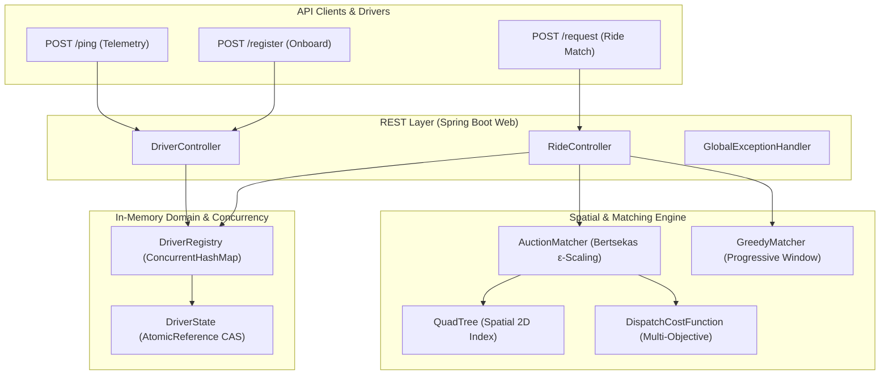

# Real-Time Ride Dispatch Matching Engine

A high-performance, concurrency-safe dispatch matching service implemented in Java 17 and Spring Boot. The system models a two-sided mobility platform that ingests high-throughput driver location telemetry, maintains spatial indexes, computes multi-objective dispatch costs, and solves the driver-rider bipartite assignment problem while preventing double-booking races under extreme concurrency.

---

## 1. Problem Statement & Architecture

In real-time ride-hailing networks, dispatching rides involves three competing requirements:
1. **Low Latency & Spatial Indexing:** Finding candidate drivers near a pickup location without full fleet $O(N)$ linear scans.
2. **Global Assignment Optimality:** Minimizing deadhead travel time and balancing fleet distribution rather than greedily consuming suboptimal drivers.
3. **Strict Concurrency Safety:** Guaranteeing that under thousands of concurrent dispatch requests, no driver can ever be double-booked to two distinct ride requests (lost-update anomaly), and driver location telemetry updates never overwrite or clear active ride claims.

### System Architecture



---

## 2. Prerequisites & Build Commands

- **Java Development Kit (JDK):** Version 17 or higher
- **Build Tool:** Apache Maven 3.9+ (or the included `./mvnw` / `mvnw.cmd` wrapper)
- **Spring Boot:** 4.1.1

### Build & Run

```bash
# Clone the repository
git clone https://github.com/AagoshRajSri/Rendezvous.git
cd Rendezvous

# Compile and package application
./mvnw clean package

# Run the Spring Boot application locally (starts on http://localhost:8080)
./mvnw spring-boot:run
```

### Running Tests

```bash
# Run full regression test suite (232 tests)
./mvnw clean test
```

---

## 3. Package & Module Structure

The project is structured under the root package `com.aagosh.dispatch`:

```
src/main/java/com/aagosh/dispatch/
├── DispatchApplication.java            # Spring Boot application bootstrap
├── api/                                # REST controllers, DTOs, and global exception handling
│   ├── DriverController.java          # Endpoints for /ping and /register
│   ├── RideController.java            # Endpoints for /request
│   ├── DriverPingRequest.java         # Telemetry ingestion payload DTO
│   ├── DriverPingResponse.java        # Telemetry ingestion response DTO
│   ├── RideRequestDto.java            # Ride match request payload DTO
│   ├── RideMatchResponse.java         # Ride match assignment response DTO
│   ├── ApiErrorResponse.java          # RFC 7807-style error payload DTO
│   └── GlobalExceptionHandler.java    # @RestControllerAdvice for validation & runtime exceptions
├── config/                             # Spring configuration and bean wiring
│   └── DispatchConfig.java            # Fallback beans for Matcher and DispatchCostConfig
├── domain/                             # Core domain entities and concurrency primitives
│   ├── Driver.java                    # Driver record with ID, GeoPoint, and DriverState
│   ├── DriverRegistry.java            # Thread-safe in-memory registry (ConcurrentHashMap)
│   ├── DriverState.java               # AtomicReference-backed CAS claiming state machine
│   ├── GeoPoint.java                  # Validated coordinate record (lat/lon)
│   ├── MatchStatus.java               # Enum: AVAILABLE, CLAIMED, UNAVAILABLE
│   └── RideRequest.java               # Ride request domain record
├── matching/                           # Dispatch cost calculation and matching algorithms
│   ├── Assignment.java                # Immutable match pair (Driver, RideRequest, cost)
│   ├── AuctionMatcher.java            # Bertsekas' Auction Algorithm with ε-scaling
│   ├── DispatchCostConfig.java        # Immutable cost function weights and normalizers
│   ├── DispatchCostFunction.java      # Multi-objective normalized cost calculator
│   ├── GreedyMatcher.java             # Progressive-radius nearest-neighbor matcher
│   └── Matcher.java                   # Core matching strategy interface
└── spatial/                            # Spatial indexing and geometric primitives
    ├── BoundingBox.java               # Coordinate bounding box with intersection logic
    └── QuadTree.java                  # Hierarchical 2D spatial index for proximity pruning
```

---

## 4. End-to-End Request Flows

### Flow 1: Driver Ingestion & Telemetry (`POST /ping`)
1. Client submits driver ID and current GPS coordinates.
2. In `DriverController`, if the driver exists, `DriverRegistry.updateLocation` performs an atomic CAS update on `AtomicReference<Driver>`.
3. The coordinate is updated while preserving the authoritative `DriverState` instance (preventing active ride claim resets).
4. If the driver is new and mode is `AUTO` (default), the driver is registered with `MatchStatus.AVAILABLE`.

### Flow 2: Ride Dispatch Matching (`POST /request`)
1. Client submits pickup location and request ID.
2. `RideController` queries `DriverRegistry.snapshot()` to snapshot active drivers.
3. The active `Matcher` (`AuctionMatcher` by default) identifies candidate drivers:
   - Candidates are indexed into a `QuadTree` spatial index.
   - Proximity search prunes drivers outside the operational radius.
   - `DispatchCostFunction` computes normalized composite costs for each (driver, request) pair.
4. If an assignment is computed, `RideController` invokes `driver.state().tryClaim(requestId)`:
   - Uses an atomic CAS transition (`AVAILABLE` $\to$ `CLAIMED`).
   - If the claim succeeds, HTTP `200 OK` is returned with `matched: true`.
   - If a concurrent request claimed the driver first, the claim returns `false`, aborting the stale assignment and returning HTTP `200 OK` with `matched: false`.

---

## 5. Core Algorithms & Cost Model

### 5.1 Spatial Indexing (`QuadTree` & Geographic Distance)
- **Indexing:** A hierarchical 2D `QuadTree` indexes driver coordinates into quadrants (NW, NE, SW, SE).
- **Pruning:** Spatial range queries test bounding-box overlap before descending, avoiding full-fleet linear scans.
- **Distance Metric:** Great-circle geographic distance is computed using the spherical Haversine formula over WGS84 coordinates ($R = 6371.0088\text{ km}$).

### 5.2 Matching Strategies (`AuctionMatcher` vs. `GreedyMatcher`)
- **`AuctionMatcher` (Bertsekas Algorithm):**
  - Formulates the driver-request dispatch as an asymmetric assignment problem.
  - Drivers act as objects with economic "prices"; ride requests act as bidders computing net benefit $\text{value} - \text{price}$.
  - Uses $\varepsilon$-scaling to guarantee convergence to an almost-optimal global assignment while avoiding cycling in degenerate cost landscapes.
- **`GreedyMatcher`:**
  - Evaluates candidate drivers within expanding progressive spatial windows ($1\text{ km} \to 3\text{ km} \to 5\text{ km}$).
  - Assigns the single lowest-cost driver available.

### 5.3 Multi-Objective Cost Model (`DispatchCostFunction`)
The composite dispatch cost balances customer pickup time and supply preservation:

$$\text{Total Cost} = w_{\text{eta}} \cdot \text{Normalized ETA} + w_{\text{density}} \cdot \text{Normalized Density} + w_{\text{opportunity}} \cdot \text{Normalized Opportunity}$$

- **Normalized ETA:** Straight-line travel time ($\text{Haversine Distance} \div 60\text{ km/h}$), normalized over reference maximum ($30\text{ minutes}$) and clamped to $[0, 1]$.
- **Normalized Competition Density:** Count of unmatched ride pickup points within $1\text{ km}$ of the candidate driver, normalized by maximum density reference ($10\text{ requests}$) and clamped to $[0, 1]$.
- **Deferred Opportunity Cost:** Evaluates to neutral **`0.0`**. The current domain model deliberately omits trip destinations and pricing tiers. Fabricating artificial opportunity values would compromise dispatch validity. Setting $w_{\text{opportunity}} = 0.0$ is supported and recommended; $w_{\text{opportunity}} > 0$ is preserved for forward compatibility.

---

## 6. Concurrency Architecture & Thread Safety

### 6.1 Atomic Driver Claiming (CAS)
In high-demand scenarios, multiple ride requests simultaneously compete for the nearest available driver. The system enforces zero double-booking via `AtomicReference<State>` in `DriverState`:

```java
State current = state.get();
if (current.status() != MatchStatus.AVAILABLE) {
    return false;
}
State claimed = new State(MatchStatus.CLAIMED, requestId);
return state.compareAndSet(current, claimed);
```
Atomic compare-and-set (CAS) using Java's `AtomicReference` ensures that only one request wins the claim. Losing requests cleanly fail without partial writes.

### 6.2 Location Updates Preserving Driver State
When a driver's GPS device pings `/ping`, their location updates in memory:
- `DriverRegistry` updates the driver's location record using a CAS loop on `AtomicReference<Driver>`.
- The new `Driver` record reuses the existing `DriverState` reference.
- **Invariant:** A telemetry ping arriving while a driver is in the `CLAIMED` status **never** resets them back to `AVAILABLE`.

### 6.3 Concurrency Limitations & Out-of-Order Telemetry
- **No Event-Time Ordering:** In-memory CAS loops commit whichever coordinate arrives last at the HTTP server. If UDP/cellular network packets arrive out-of-order, a stale physical location can overwrite a fresher one. Sequence numbers and Lamport clocks are planned for subsequent milestones.
- **Single-Node In-Memory State:** Current concurrency safety is guaranteed within a single JVM. Distributed coordination across multi-node clusters requires external distributed locks or partition-keyed event routing.

---

## 7. API Quick Start

### 7.1 Register Driver (`POST /register`)

```bash
curl -X POST http://localhost:8080/register \
  -H "Content-Type: application/json" \
  -d '{
    "driverId": "D101",
    "latitude": 17.385044,
    "longitude": 78.486671
  }'
```

**Response (`201 Created`):**
```json
{
  "driverId": "D101",
  "status": "REGISTERED",
  "latitude": 17.385044,
  "longitude": 78.486671,
  "matchStatus": "AVAILABLE",
  "message": "Driver registered successfully"
}
```

### 7.2 Ingest Telemetry (`POST /ping`)

```bash
curl -X POST http://localhost:8080/ping \
  -H "Content-Type: application/json" \
  -d '{
    "driverId": "D101",
    "latitude": 17.389200,
    "longitude": 78.489100,
    "action": "AUTO"
  }'
```

**Response (`200 OK`):**
```json
{
  "driverId": "D101",
  "status": "UPDATED",
  "latitude": 17.3892,
  "longitude": 78.4891,
  "matchStatus": "AVAILABLE",
  "message": "Driver location updated successfully"
}
```

### 7.3 Request Ride Match (`POST /request`)

```bash
curl -X POST http://localhost:8080/request \
  -H "Content-Type: application/json" \
  -d '{
    "requestId": "REQ-789",
    "latitude": 17.387000,
    "longitude": 78.488000
  }'
```

**Response (`200 OK`):**
```json
{
  "requestId": "REQ-789",
  "matched": true,
  "driverId": "D101",
  "driverLatitude": 17.3892,
  "driverLongitude": 78.4891,
  "driverStatus": "CLAIMED",
  "cost": 0.04381,
  "message": "Driver assigned successfully"
}
```

---

## 8. Testing & Verification

The project enforces comprehensive test coverage across unit, spatial, mathematical, concurrency, and REST layers.

```bash
./mvnw clean test
```

### Verified Test Suite Breakdown (232 Tests, 0 Failures)

| Test Class | Category | Test Count | Scope Verified |
| :--- | :--- | :---: | :--- |
| `QuadTreeTest` | Spatial | 16 | Quadrant subdivision, boundary conditions, range query pruning |
| `BoundingBoxTest` | Spatial | 10 | Bounding-box intersection, coordinate clamping, containment |
| `DispatchCostFunctionTest` | Mathematical | 61 | Normalization clamping, weights, edge cases, Haversine formula |
| `AuctionMatcherTest` | Algorithm | 40 | Bertsekas auction matching, ε-scaling, optimality comparisons |
| `GreedyMatcherTest` | Algorithm | 15 | Progressive radius windows, nearest-neighbor driver selection |
| `DispatchIntegrationTest` | Integration | 9 | End-to-end matching integration across cost model and spatial index |
| `DriverStateTest` | Concurrency | 2 | Single-thread state machine transitions |
| `DriverStateConcurrencyTest` | Concurrency | 20 | Multi-threaded CAS claims, state preservation during updates |
| `DriverRegistryTest` | Concurrency | 24 | Concurrent registrations, CAS location updates, snapshot isolation |
| `GeoPointTest` | Validation | 8 | Latitude/longitude bounds, NaN/infinite rejection, error messages |
| `RideControllerTest` | REST API | 7 | Endpoints `/request`, HTTP status mapping, 16-thread claim races |
| `DriverControllerTest` | REST API | 10 | Endpoints `/ping`, `/register`, conflict handling, invalid payload |
| `AdditionalControllerTest` | REST / Errors | 3 | HTTP 500 error handling, 16-thread Greedy claims, concurrent `/ping` auto-fallback |
| `DispatchConfigTest` | Spring Boot | 3 | Bean fallback resolution and custom Matcher bean override |
| `DispatchApplicationTests` | Smoke | 5 | ApplicationContext initialization and @RestController bean discovery |
| **Total** | | **232** | **100% Passing (0 failures, 0 errors, 0 skipped)** |

---

## 9. Controlled Double-Booking Experiment

To demonstrate the concrete failure mode of non-atomic state updates, a reproducible concurrency experiment is maintained on the isolated branch `experiment/double-booking`.

- **Check-then-Set Vulnerability:** Demonstrates how non-atomic reads followed by writes cause two concurrent threads to both claim the same driver.
- **Atomic CAS Resolution:** Contrasts the vulnerability against production `DriverState.tryClaim` using Java's `AtomicReference`, proving 100% single-winner determinism under high concurrency.
- **Full Experiment Report:** See [docs/double-booking-experiment.md](docs/double-booking-experiment.md).

---

## 10. Architectural Stubs & Current Limitations

1. **Declared but Unused Infrastructure:** `docker-compose.yml` declares PostgreSQL, Redis, and Kafka containers as architectural blueprints for future persistence, distributed caching, and event streaming. The current service runs completely in-memory and does not connect to these containers.
2. **Absence of Road Network Routing:** ETA estimates are derived using spherical Haversine straight-line distance at a nominal $60\text{ km/h}$. Turn penalties, one-way streets, and real-time traffic congestion are not modeled.
3. **Single-Node In-Memory Footprint:** The spatial index and driver registry reside entirely in JVM heap. Scaling across multiple replicas requires distributed spatial indexing (e.g., Uber H3 or Redis GEO) and distributed consensus.

---

## 11. Reference Documentation

- [REST API Specification](API_DOCUMENTATION.md) — Complete endpoint schemas, parameter matrices, and error response examples.
- [Double-Booking Experiment Documentation](docs/double-booking-experiment.md) — In-depth concurrency race condition analysis and atomic CAS verification using Java's `AtomicReference`.
